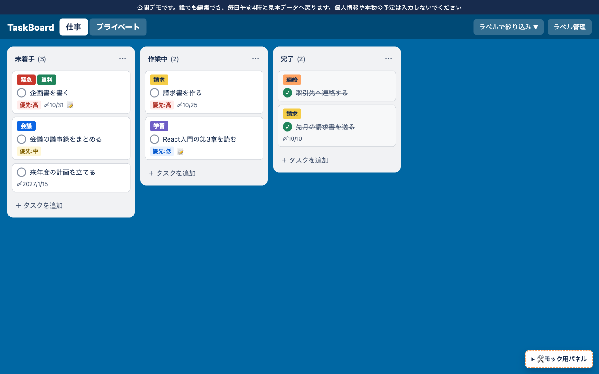
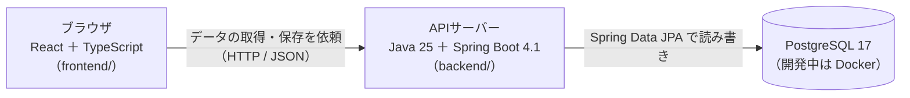

# TaskBoard（Trello風タスク管理アプリ）

タスクを「未着手 → 作業中 → 完了」の3つのカラムで見える化する、Trello風のタスク管理アプリです。
AIエンジニアコース（スクール）初級編の課題1作目として、要件定義から設計・実装・公開までを、Claude Code と一緒に進めています。

> 🚧 **開発中**です。ボード画面の表示とキーワード検索までできています（2026-11-20 時点。進み具合は「8. 進み具合」）。



*画面のイメージ。モック（`mock/`）で作った試作品で、本物のアプリはこれを手本に作っています。*

---

## 1. このアプリでできること

| 機能 | 内容 | 状態 |
|---|---|---|
| ボード | 「仕事」と「プライベート」の2つのボードを、タブで切り替える。ボードの名前は変えられる | 切り替えは済み。名前の変更は予定 |
| カラム | 「未着手」「作業中」「完了」の3つ。カラムごとに件数を出す | 済み |
| タスク | タイトル（必須）・説明・優先度（高・中・低）・期限日を持つ。作成・編集・削除ができる | 表示・作成・編集は済み。削除は予定 |
| ドラッグ＆ドロップ | カードをドラッグして、カラムの移動と並び替えができる | 予定 |
| 完了チェック | カラムとは別に ✓ を付け外しできる（チェックしてもカードは動かない） | 予定 |
| ラベル | 6色から選べるラベル。1つのタスクに複数付けられ、ラベルで絞り込める | 表示は済み。付け外し・絞り込み・管理は予定 |
| キーワード検索 | タイトルと説明の文字で絞り込む。件数は「表示中／全体」で出る | 済み |
| 整列 | 優先度順・期限順に並べ直す | 予定 |
| 保存 | データベースに保存するので、ブラウザを閉じても、別の PC から開いても同じデータが見られる | 済み（読み取り） |
| 公開デモ | 誰でも触れるデモとして公開し、毎日 午前4時に見本データへ戻す | 予定 |

- ログイン機能はなく、全員が同じデータを見ます（公開デモのため、本物の予定や個人情報は入れません）。
- 詳しい機能とルールは [機能一覧](docs/機能一覧.md)、画面の部品と動きは [画面設計](docs/画面設計.md) にあります。

---

## 2. 技術スタック

コースの指定（**バックエンドは Java ＋ Spring Boot、フロントエンドは React、データベースは PostgreSQL**）に合わせて選びました。
版は 2026-11-19 に最新版と見比べて確かめています。

| 分野 | 主な技術 | 詳しい資料 |
|---|---|---|
| フロントエンド（画面） | React 19.3 ・ TypeScript 6.0 ・ Vite 8.3 ・ Tailwind CSS 4.3 ・ TanStack Query 5.107 ・ Zod 4.6 ・ Node.js 22.23 ・ npm 10.9 | [フロントエンド](docs/技術スタック/フロントエンド.md) |
| バックエンド（APIサーバー） | Java 25（LTS）・ Spring Boot 4.1.2 ・ Spring Data JPA（Hibernate 7.4）・ Flyway 12.4 ・ Gradle 9.8 | [バックエンド](docs/技術スタック/バックエンド.md) |
| データベース | PostgreSQL 17.11（開発中は Docker で動かす） | [データベース](docs/技術スタック/データベース.md) |
| 開発ツール | Cursor ・ Claude Code ・ Git / GitHub ・ Docker ・ Vitest ・ React Testing Library ・ MSW ・ JUnit 6 ・ Mockito ・ ESLint ・ Prettier | [開発ツール](docs/技術スタック/開発ツール.md) |

- TypeScript は 7 が出ていますが、書き方の点検の道具（typescript-eslint）がまだ対応していないので、6.0 を使っています。
- 版の一覧と選んだ理由のまとめは [技術スタック](docs/技術スタック.md) にあります。

### 2.1 しくみ（システム構成）



- 画面はデータベースに直接つながらず、必ず APIサーバーを通します。
- 開発中は、画面の開発サーバー（Vite）が `/api` で始まる依頼を APIサーバーへ中継します。

---

## 3. フォルダ構成

```
task-management-app/
├─ README.md        この案内
├─ CLAUDE.md        Claude Code が守る開発のルール
├─ compose.yaml     開発用のデータベース（Docker の PostgreSQL）の設定
├─ .env.example     .env の見本（データベースのパスワードなど）
├─ .claude/         Claude Code の設定（許可・拒否リスト、サーバー起動の手順）
├─ docs/            仕様書（要件定義書・設計書・技術スタック）
├─ mock/            画面のモック（HTML・CSS・JavaScript だけで作った試作品）
├─ backend/         APIサーバー（Java ＋ Spring Boot）
└─ frontend/        画面（React ＋ TypeScript）
```

---

## 4. はじめての準備（1回だけ）

必要なもの：**Docker Desktop**・**Java 25**・**Node.js 22**（Gradle は `./gradlew` が自動で用意するので、入れなくてよい）

```bash
# 1. データベースの設定ファイルを作り、POSTGRES_PASSWORD を自分だけの値に変える（英数字と _ だけ）
cp .env.example .env

# 2. 画面の部品を入れる
cd frontend
npm ci
```

- `.env` は GitHub に上げません（`.gitignore` で除外済み）。
- `.env` のパスワードは、データベースを最初に作ったときだけ使われます。あとで変えると接続できなくなります。

---

## 5. 起動のしかた

Docker Desktop を開いてから、上から順に起動します。**ポートの番号は変えません**（使われていたら、使っているものを止めてから起動する）。

| 順番 | 対象 | 場所 | コマンド | ポート | 開く URL |
|---|---|---|---|---|---|
| 1 | データベース | リポジトリ直下 | `docker compose up -d` | 5433 | （画面はない） |
| 2 | APIサーバー | `backend/` | `./gradlew bootRun` | 8080 | http://localhost:8080/actuator/health |
| 3 | 画面 | `frontend/` | `npm run dev` | 5173 | http://localhost:5173 |

- APIサーバーの health に `{"status":"UP"}` と出れば、データベースにもつながっています。
- 止めるとき：画面と APIサーバーはターミナルで `Ctrl + C`、データベースは `docker compose stop`（データは残ります）。
- どのサーバーも、この PC からだけ開けます（同じ Wi-Fi の他の機器からは開けません）。
- うまく動かないときは、[データベース](docs/技術スタック/データベース.md) の5章と [開発ツール](docs/技術スタック/開発ツール.md) を見てください。

### 5.1 テストと点検

| 対象 | 場所 | コマンド |
|---|---|---|
| APIサーバーのテスト | `backend/` | `./gradlew test` |
| 画面のテスト | `frontend/` | `npm test`（カバレッジは `npm run coverage`。80% 以上が基準） |
| 画面の書き方の点検 | `frontend/` | `npm run lint` |
| 画面のビルド（型のチェック込み） | `frontend/` | `npm run build` |

---

## 6. 開発の進め方

GitHub での作業は、[CLAUDE.md](CLAUDE.md) のルールにしたがって、次の順で進めます。

1. **イシュー**を作る（やることと、終わりの条件を書く）
2. 最新の main から**ブランチ**を作る（名前は `feature/#イシュー番号-短い説明`）
3. **コミット**する（メッセージは日本語。例：`feat: 画面のひな型を追加する`）
4. **PR** を作る（本文に `Closes #イシュー番号` を書く）
5. 自分で確かめて**マージ**する
6. 手元の main を最新にする（`git switch main` → `git pull`）

- main へ直接プッシュしません。
- 決まりの詳しい内容は [開発ツール](docs/技術スタック/開発ツール.md) の5章にあります。

---

## 7. 資料の一覧

| 資料 | 書いてあること |
|---|---|
| [要件定義書](docs/要件定義書.md) | 何を作るか・どこまで作るか、背景と目的、決定事項、今後の進め方（最初に読む資料） |
| [機能一覧](docs/機能一覧.md) | できること、細かい動作ルール、操作の流れ、受け入れ条件 |
| [画面設計](docs/画面設計.md) | 画面の一覧、画面のつながり、各画面の部品と動き |
| [DB設計](docs/DB設計.md) | テーブルの形とつながり（ER図）、見本データ |
| [API設計](docs/API設計.md) | 画面とサーバーのやりとり（どの URL に何を送り、何が返るか） |
| [非機能要件](docs/非機能要件.md) | 対応環境、性能、セキュリティ、アクセシビリティなど |
| [技術スタック](docs/技術スタック.md) | 使う技術と版の一覧、構成図、公開先、環境変数 |
| ┗ [フロントエンド](docs/技術スタック/フロントエンド.md)・[バックエンド](docs/技術スタック/バックエンド.md)・[データベース](docs/技術スタック/データベース.md)・[開発ツール](docs/技術スタック/開発ツール.md) | 分野ごとの技術・版・設定・コマンド |
| [モック](mock/README.md) | 画面の見た目と動きを確かめる試作品と、検証用のチェックリスト |

- `.md` の資料は、Cursor で開いて `Cmd + K` → `V` を押すと、見やすい表示（プレビュー）で読めます。

---

## 8. 進み具合

| Step | やること | 状態 |
|---|---|---|
| 1〜5 | 要件定義・画面設計・データ設計・モック・技術選定 | ✅ 済み |
| 6 | 環境構築（APIサーバー・データベース・画面） | ✅ 済み |
| 7 | API設計 | 読み取りとタスク作成の API は済み。更新・削除はこれから |
| 8 | 実装 | 見本データ・読み取りの API・ボード画面の表示・キーワード検索・タスクの作成（API と画面のモーダル S-02）・タスクの編集（API と画面のモーダル S-03）は済み（イシュー #7・#9・#11・#15）。**次はタスクの削除（F-12）** |
| 9 | テスト | 実装と一緒に書いている |
| 10 | 公開 | これから |

実装の順番と、それぞれの詳しい内容は [要件定義書](docs/要件定義書.md) の5章にあります。
