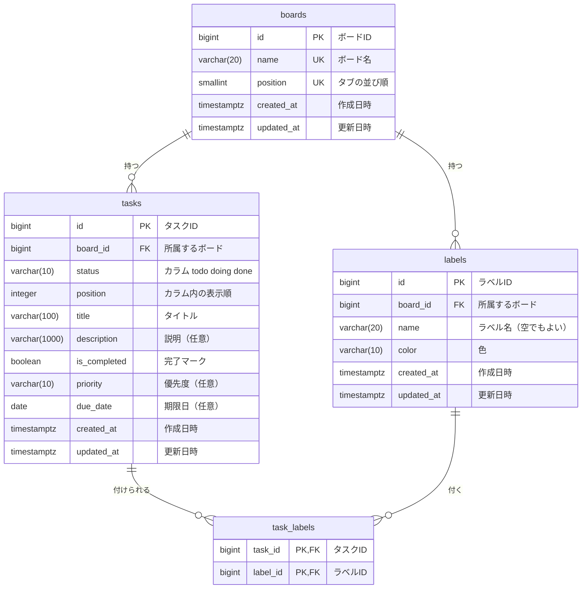

# DB設計：TaskBoard

| 項目 | 内容 |
|---|---|
| 版 | v1.1 |
| 更新日 | 2026-10-27 |
| 親ドキュメント | [要件定義書](要件定義書.md) |

> 💡 **このドキュメントの役割**
> 何をどんな形でデータベースに保存するかを決める。ここを先に決めておくと、実装が楽になる。
> 画面・APIサーバー・データベースのつながりは [技術スタック](技術スタック.md) の「システム構成図」を見る。
>
> **IDの見方**：F 機能・R 動作ルール（[機能一覧](機能一覧.md)）、N 非機能要件（[非機能要件](非機能要件.md)）、Q 決定事項（[要件定義書](要件定義書.md)）。
> この文書では、ボードの縦の列を「カラム」、テーブルの項目を「列」と呼んで区別する。

---

## 1. 方針

- データは**データベースに保存**する（v1 のブラウザ保存から変更：Q18）。
- 画面（フロントエンド）は、データベースに直接つながらない。**自作の APIサーバー（バックエンド）を通して**読み書きする。
- ログインはないので、**ユーザーのテーブルは作らない**。全員が同じデータを見る。
- テーブルは4つ：`boards`（ボード）、`tasks`（タスク）、`labels`（ラベル）、`task_labels`（タスクとラベルの結び付け）（Q19）。
- ボードのカラム（未着手／作業中／完了）は3つで固定なので、テーブルにせず `tasks.status` の値で表す。
- データベースは **PostgreSQL 17**（Q8・[技術スタック](技術スタック.md)）。テーブルは **Flyway のマイグレーション**（SQL ファイル）で作り、Spring Data JPA はテーブルの形が合っているかだけを確かめる（JPA にテーブルを作らせない）。

---

## 2. ER図

- 1つのボードは、たくさんのタスクとラベルを持つ。
- タスクとラベルは「多対多」（1つのタスクに複数のラベル、1つのラベルは複数のタスクに付く）なので、間に `task_labels` を置いて結び付ける。

---

## 3. テーブル定義

> 型は PostgreSQL 17 のもの（確定）。このテーブル定義のとおりに、Flyway のマイグレーションの SQL を書く。
>
> **型の読み方**：`BIGINT`＝大きな整数、`SMALLINT`／`INTEGER`＝整数、`VARCHAR(n)`＝最大 n 文字の文字列、`BOOLEAN`＝true／false、`DATE`＝日付、`TIMESTAMPTZ`＝タイムゾーン付きの日時。
> **NULL**：「値なし」を許すかどうか。
>
> **日付と時刻**：期限日（`due_date`）は日付だけで、時刻もタイムゾーンも持たない。API では `"2026-10-31"` のような日付だけの文字列でやりとりする。「今日」はブラウザの日付で決める。作成・更新日時は `TIMESTAMPTZ`。詳しくは [技術スタック](技術スタック.md) の「日付と時刻の扱い」。

### 3.1 boards（ボード）

| 列名 | 型 | NULL | 初期値 | 説明・ルール |
|---|---|---|---|---|
| id | BIGINT | 不可 | 自動で採番 | 主キー |
| name | VARCHAR(20) | 不可 | | ボード名。1〜20文字。ほかのボードと同じ名前は不可（UNIQUE） |
| position | SMALLINT | 不可 | | タブの並び順（0＝左、1＝右）。UNIQUE |
| created_at | TIMESTAMPTZ | 不可 | 今の日時 | 作成日時 |
| updated_at | TIMESTAMPTZ | 不可 | 今の日時 | 更新日時 |

- 行は「仕事」「プライベート」の2行だけで、追加・削除はしない。

### 3.2 tasks（タスク）

| 列名 | 型 | NULL | 初期値 | 説明・ルール |
|---|---|---|---|---|
| id | BIGINT | 不可 | 自動で採番 | 主キー |
| board_id | BIGINT | 不可 | | 外部キー → `boards.id` |
| status | VARCHAR(10) | 不可 | `'todo'` | どのカラムにあるか。`todo`（未着手）／`doing`（作業中）／`done`（完了）のどれか（CHECK 制約） |
| position | INTEGER | 不可 | | カラム内の表示順。0 から始まる連番で、小さいほど上 |
| title | VARCHAR(100) | 不可 | | タイトル。1〜100文字。前後の空白は除いて保存 |
| description | VARCHAR(1000) | 可 | NULL | 説明。NULL＝説明なし |
| is_completed | BOOLEAN | 不可 | false | 完了マーク（✓）の有無 |
| priority | VARCHAR(10) | 可 | NULL | 優先度。`high`／`medium`／`low` のどれか（CHECK 制約）。NULL＝なし |
| due_date | DATE | 可 | NULL | 期限日（時刻なし）。NULL＝期限なし |
| created_at | TIMESTAMPTZ | 不可 | 今の日時 | 作成日時 |
| updated_at | TIMESTAMPTZ | 不可 | 今の日時 | 更新日時 |

- 索引（インデックス）：`(board_id, status, position)`。ボードを開いたとき、カラムごとに順番どおり速く取り出すため。
- 1つのボードのタスクは最大200件（R-29）。サーバー側でチェックする。

### 3.3 labels（ラベル）

| 列名 | 型 | NULL | 初期値 | 説明・ルール |
|---|---|---|---|---|
| id | BIGINT | 不可 | 自動で採番 | 主キー |
| board_id | BIGINT | 不可 | | 外部キー → `boards.id` |
| name | VARCHAR(20) | 不可 | `''`（空の文字） | ラベル名。0〜20文字。名前なしは空の文字で表す |
| color | VARCHAR(10) | 不可 | | `green`／`yellow`／`orange`／`red`／`purple`／`blue` のどれか（CHECK 制約） |
| created_at | TIMESTAMPTZ | 不可 | 今の日時 | 作成日時 |
| updated_at | TIMESTAMPTZ | 不可 | 今の日時 | 更新日時 |

- `(board_id, color, name)` の組み合わせは UNIQUE（同じボードに、色も名前も同じラベルは作れない：R-17）。
- 名前なしを NULL ではなく空の文字にするのは、NULL だと上の重複チェックが効かないため。
- 1つのボードのラベルは最大20個（R-17）。サーバー側でチェックする。

### 3.4 task_labels（タスクとラベルの結び付け）

| 列名 | 型 | NULL | 初期値 | 説明・ルール |
|---|---|---|---|---|
| task_id | BIGINT | 不可 | | 外部キー → `tasks.id`。タスクを削除したら、この行も一緒に消える（ON DELETE CASCADE） |
| label_id | BIGINT | 不可 | | 外部キー → `labels.id`。ラベルを削除したら、この行も一緒に消える（ON DELETE CASCADE）。これで「ラベルを消すとタスクからも外れる」が実現できる |

- 主キーは `(task_id, label_id)` の組み合わせ（同じラベルを同じタスクに2回付けられない）。
- タスクと同じボードのラベルしか付けられない。サーバー側でチェックする。

---

## 4. 見本データ

公開デモの初期状態と、毎日のリセット後の状態（F-55）。

| テーブル | 中身 |
|---|---|
| boards | 「仕事」（position 0）、「プライベート」（position 1） |
| labels | 仕事：緊急（赤）・請求（黄）・会議（青）・資料（緑）・連絡（オレンジ）・学習（紫） プライベート：大事（赤）・家事（黄）・健康（青）・買い物（緑）・趣味（オレンジ）・予定（紫） |
| tasks | 各ボードに5件程度。3つのカラムにばらけさせ、優先度・期限・ラベル・チェック済みの例を含める（具体的な中身は実装のときに決める） |

- **期限日は相対日付で入れる**：「リセットした日（日本時間）から3日後」のように決める。固定の日付にすると、次の日から全部「期限切れ」になってしまうため。
- **入れ方**：見本データは Flyway のマイグレーションには入れず、APIサーバー（Java）の1つの部品にまとめる。初回起動と毎日のリセット（F-55）の両方で同じものを使う。

---

## 5. ブラウザに保存するもの

- 「最後に開いていたボードのID」だけは、データベースではなくブラウザ（localStorage）に保存する（F-04）。
- 理由：見る人ごとに違ってよい「表示の好み」であり、全員で共有するデータではないため。

---

## 6. 変更履歴

| 版 | 日付 | 内容 |
|---|---|---|
| v1.0 | 2026-10-20 | 要件定義書 v2.0 の「データ設計」を移して作成（システム構成図は技術スタックへ移動） |
| v1.1 | 2026-10-27 | PostgreSQL 17 で確定。テーブルは Flyway で作ることを明記。日付と時刻の扱い、見本データの期限を相対日付にすることと入れ方を追加 |
