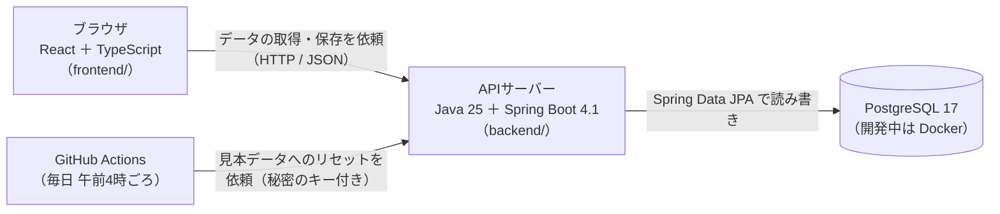

# 技術スタック：TaskBoard

| 項目 | 内容 |
|---|---|
| 版 | v3.1 |
| 更新日 | 2026-11-19 |
| 親ドキュメント | [要件定義書](要件定義書.md) |
| ステータス | 確定（バージョンはメジャー・マイナーまで決める。細かい版（パッチ）は、追加するときの最新を使う） |

> 💡 **このドキュメントの役割**
> どの部分を、どんな技術（とバージョン）で作るか、なぜそれを選んだかをまとめる。AIに実装を頼むときも、このドキュメントを渡せば、使う技術がブレない。
> v3.0 から、詳しい内容を **フロントエンド・バックエンド・データベース・開発ツールの4つのファイル**（`docs/技術スタック/`）に分けた。このドキュメントには、全体の案内と、4つにまたがる内容（構成図・公開先・環境変数・日付の扱いなど）を残している。
>
> **IDの見方**：F 機能・R 動作ルール・UC ユースケース（[機能一覧](機能一覧.md)）、N 非機能要件（[非機能要件](非機能要件.md)）、Q 決定事項（[要件定義書](要件定義書.md)）。

---

## 1. 資料の一覧と、技術の決め方

### 1.1 4つの資料

| 資料 | 書いてあること |
|---|---|
| [フロントエンド](技術スタック/フロントエンド.md) | React・TypeScript・Vite・Tailwind CSS・TanStack Query・Zod の版と選んだ理由、`frontend/` のフォルダ構成、主な設定、npm のコマンド |
| [バックエンド](技術スタック/バックエンド.md) | Java・Spring Boot・Gradle と、Spring Boot が版を決める部品（JPA・Flyway など）、これから入れる部品、`backend/` のフォルダ構成、主な設定、実装の注意 |
| [データベース](技術スタック/データベース.md) | PostgreSQL・Docker の版と選んだ理由、開発用データベース（`compose.yaml`）の設定、Flyway の使い方、よく使うコマンド、うまく動かないとき |
| [開発ツール](技術スタック/開発ツール.md) | エディタ・AI（Claude Code）・Git・GitHub、テストと書き方の点検の道具、開発環境の準備、起動のしかた、開発の進め方 |

### 1.2 決め方

- コースの指定：**バックエンドは Java ＋ Spring Boot、フロントエンドは React（Next.js は対象外）、データベースは PostgreSQL**（Q8）。
- それ以外は、この3つに合わせて選んだ。Tailwind CSS と Gradle はコースの推奨どおり（Q28）。
- データベースの読み書きは Spring Data JPA（Q25）、画面の言語は TypeScript（Q26）、フォルダ構成は1つのリポジトリに `backend/` と `frontend/` を並べる（Q27）。開発中のデータベースは Docker で動かす（Q29）。
- 版は、**いちばん新しい安定版**を基本にする。ただし、長期サポート（LTS）があるものは LTS を選び、組み合わせて動かない版は避ける（例：TypeScript は 6.0、[フロントエンド](技術スタック/フロントエンド.md) の2.2）。

---

## 2. システム構成図



- 画面はデータベースに直接つながらず、必ず APIサーバーを通す（[DB設計](DB設計.md) の「方針」）。
- 「最後に開いていたボード」だけはブラウザ（localStorage）に保存する（F-04）。
- 開発中は、Vite の開発サーバー（http://localhost:5173）が `/api` で始まる依頼を APIサーバー（http://localhost:8080）へ中継する（proxy）。そのため、開発中は CORS の設定がいらない。
  - 中継先は `http://127.0.0.1:8080` と書く。APIサーバーは `127.0.0.1` だけで待っていて（[バックエンド](技術スタック/バックエンド.md) の3章）、`localhost` と書くと、IPv6 の `::1` に向かって失敗することがあるため。

---

## 3. 版の一覧（まとめ）

2026-11-19 に、入っている版と最新版を確かめた。詳しくは4つの資料にある。

**記号**：✅ 最新／🔼 新しい版がある（上げてよい）／⏸ 新しい版があるが、理由があって今は上げない／⏳ まだ入れていない

| 分野 | 技術 | 入っている版 | 最新版 | 判定 |
|---|---|---|---|---|
| フロントエンド | React | 19.3.1 | 19.3.1 | ✅ |
| フロントエンド | TypeScript | 6.0.3 | 7.0.2 | ⏸ 書き方の点検（typescript-eslint）が 7 に未対応 |
| フロントエンド | Vite | 8.3.8 | 8.3.8 | ✅ |
| フロントエンド | Tailwind CSS | 4.3.5 | 4.3.5 | ✅ |
| フロントエンド | TanStack Query | 5.107.1 | 5.108.0 | 🔼 |
| フロントエンド | Zod | 4.6.7 | 4.6.7 | ✅ |
| フロントエンド | Node.js | 22.23.4 | 22 系：22.23.5（LTS の最新は 26） | 🔼 |
| フロントエンド | npm | 10.9.9 | 12.2.3 | ⏸ Node.js に付属する版を使う |
| バックエンド | Java | 25.0.5 | LTS の最新は 25 | ✅ |
| バックエンド | Spring Boot | 4.1.2 | 4.1.2（4.2 は試験版） | ✅ |
| バックエンド | Gradle | 9.8.2 | 9.9.1 | 🔼 |
| データベース | PostgreSQL | 17.11（`postgres:17-alpine`） | 17 系：17.12／いちばん新しいのは 18.7 | 17.12 へは 🔼／18 へは ⏸ 公開先・CI と 17 にそろえる |
| 開発ツール | Vitest | 5.1.0 | 5.1.1 | 🔼 |
| 開発ツール | ESLint | 10.14.0 | 10.15.0 | 🔼 |
| 開発ツール | Playwright | — | 1.65.1 | ⏳ E2E テストを作るとき |

- 🔼 はどれも小さな更新。上げるときは、まとめて1つのイシューにし、テストが通ることを確かめる。

---

## 4. フォルダ構成（リポジトリ全体）

```
task-management-app/
├─ README.md        このアプリの案内（最初に読む）
├─ CLAUDE.md        Claude Code が守る開発のルール
├─ compose.yaml     開発用のデータベース（Docker の PostgreSQL）の設定
├─ .env.example     .env の見本（GitHub に上げる）
├─ .env             データベースのパスワードなど（自分の PC だけ。GitHub に上げない）
├─ .claude/         Claude Code の設定（許可・拒否リスト、サーバー起動の手順）
├─ docs/            仕様書（このドキュメントなど）
│   └─ 技術スタック/  フロントエンド・バックエンド・データベース・開発ツール
├─ mock/            画面のモック（HTML・CSS・JavaScript）
├─ backend/         APIサーバー（Spring Boot）… 詳しくは バックエンド の2章
└─ frontend/        画面（React）… 詳しくは フロントエンド の3章
```

---

## 5. 公開先と毎日のリセット（候補。公開のステップで最終確認）

| 対象 | 候補 | 無料枠の主な条件 |
|---|---|---|
| 画面 | Render の Static Site | 無料。毎月の通信量とビルド時間に上限がある |
| APIサーバー | Render の Web Service（Docker で動かす） | 15分アクセスがないと休止し、次の起動に約1分。メモリは約512MB |
| データベース | Neon Free（PostgreSQL 17） | 0.5GB まで。5分で休止するが、接続すれば起き上がる。期限なし |
| 毎日のリセット | GitHub Actions の定期実行（UTC 19:00＝日本時間 午前4時） | 秘密キー付きでリセット API を呼ぶ。休止中のサーバーを起こす役目も兼ねる |

**分かっているリスクと対策**

- **Dockerfile が必要**：Render には Java 用の標準の実行環境がないので、Dockerfile で動かす。PC に Docker が入ったので、公開の前に手元で Dockerfile を試せる。
  - Dockerfile には `ENV SERVER_ADDRESS=0.0.0.0` を書く。開発中の設定（`127.0.0.1`）のままだと、コンテナの外から届かず、公開先でサイトが開かない。
  - Render は、待ち受けるポート番号を環境変数 `PORT`（初期値 10000）で知らせてくる。Spring Boot は 8080 で待つので、`server.port=${PORT:8080}` にするか、Render 側の `PORT` を 8080 にして合わせる（公開のステップで確かめる）。
- **メモリが少ない**：Spring Boot には約512MB はぎりぎり。JVM のメモリ設定（`MaxRAMPercentage=75` など）、データベースの接続数（3〜5）、`spring.jpa.open-in-view=false` で節約する。
- **休止と起動待ち**：休止明けは数十秒〜1分かかる（N-03 で許容済み）。
- **リセットの遅れ**：GitHub Actions の定期実行は、数分〜数十分遅れることがある。また、公開リポジトリは60日間動きがないと止まる。呼び出しには、やり直しと長めの待ち時間を付ける（R-30、N-07）。
- **Neon への接続**：中継（PgBouncer）を通さない直接接続にし、`sslmode=require` を付け、Render と同じ地域を選ぶ。
- **Render の無料データベースは使わない**：30日で消えるため。

---

## 6. 環境変数

秘密の情報や、場所によって変わる値は、プログラムに書かず環境変数で渡す（N-15）。

**開発中（自分の PC）**：リポジトリ直下の `.env` に書く。見本は `.env.example`。

| 名前 | 使う場所 | 中身 | 秘密か |
|---|---|---|---|
| `POSTGRES_DB` | Docker ・ backend | データベースの名前（`taskboard_dev`） | 秘密ではない |
| `POSTGRES_USER`・`POSTGRES_PASSWORD` | Docker ・ backend | データベースのユーザー名とパスワード | パスワードは秘密 |
| `TASKBOARD_DB_PORT` | Docker ・ backend | 自分の PC から接続するポート番号（`5433`） | 秘密ではない |

- Docker（`compose.yaml`）と Spring Boot の両方が、同じ `.env` を読む。Spring Boot は `.env` を自動では読まないので、`application.properties` の `spring.config.import` で読み込みを指定している。
- `.env` の値は英数字と `_` だけにする。引用符や `$` などの記号は、Docker と Spring Boot で読み方が違うため。

**公開先**：公開先の管理画面で、本物の環境変数として設定する。

| 名前（案） | 使う場所 | 中身 | 秘密か |
|---|---|---|---|
| `SPRING_DATASOURCE_URL` | backend | データベースの場所（`jdbc:postgresql://…`） | 公開先では秘密として扱う |
| `SPRING_DATASOURCE_USERNAME`・`SPRING_DATASOURCE_PASSWORD` | backend | データベースのユーザー名とパスワード | 秘密 |
| `TASKBOARD_RESET_SECRET` | backend ・ GitHub Actions | リセット API の秘密キー（N-14） | 秘密 |
| `TASKBOARD_ALLOWED_ORIGIN` | backend | API を呼んでよい画面の URL（CORS、N-16） | 秘密ではない |
| `VITE_API_BASE_URL` | frontend | 画面から見た API の URL | 秘密ではない |
| `SERVER_ADDRESS` | backend（Dockerfile に書く） | サーバーが接続を待つ入口。`0.0.0.0`＝すべての入口（外から開ける） | 秘密ではない |

- `SPRING_DATASOURCE_*` は、`application.properties` の接続設定より優先される。公開先では、この3つで接続先を切り替える。
- `SERVER_ADDRESS` も同じく、`application.properties` の `server.address=127.0.0.1`（開発中は、この PC からだけ開ける）より優先される。下の ⚠️ と同じく、`.env` に書いても効かない。
- ⚠️ `SPRING_DATASOURCE_URL` のような大文字の名前は、**本物の環境変数でしか効かない**。`.env` に書いても無視される。
- `VITE_` で始まる変数は、画面のプログラムに埋め込まれて**誰でも見られる**。秘密は入れない。
- `.env` は `.gitignore` に入れてあり、GitHub に上げない。

---

## 7. 日付と時刻の扱い

| データ | データベース | Java | API（JSON） | 画面 |
|---|---|---|---|---|
| 期限日 | `DATE` | `LocalDate` | `"2026-10-31"`（日付だけの文字列） | 文字列のまま扱い、`new Date("2026-10-31")` は使わない（時差で1日ずれることがある） |
| 作成・更新日時 | `TIMESTAMPTZ` | `OffsetDateTime` | 時差つきの日時の文字列 | 表示しない（今は使い道なし） |

- 「今日」（期限切れの判定・F-15、表示の年・R-11）は、**ブラウザの日付**で決める。
- 見本データの期限は、**リセットした日（日本時間）からの相対日付**（例：3日後）で入れる。固定の日付にすると、次の日から全部「期限切れ」になってしまうため（[DB設計](DB設計.md)）。

---

## 8. 非機能要件をどう満たすか

| ID | 内容 | 使う技術・やり方 |
|---|---|---|
| N-03 | 休止明けの起動待ちを許容 | 公開先の休止を受け入れる。起動したかは Actuator の health で確かめる |
| N-11 | SQL はプレースホルダで組み立てる | Spring Data JPA が値を埋め込む。文字列をつなげて SQL を作らない |
| N-12 | サーバー側の入力チェック | Bean Validation ＋ service でのルール確認（件数の上限・同じボードかなど） |
| N-13 | 書き込みの回数制限と 10KB 制限 | Bucket4j ＋ 送られてきた大きさを見る自作フィルタ（大きすぎたら 413 を返す） |
| N-14 | リセット機能の保護 | 秘密のヘッダーを `MessageDigest.isEqual` で比べる。POST だけ受け付ける |
| N-15 | 秘密は環境変数に | 6章 |
| N-16 | HTTPS と CORS | HTTPS は公開先が用意する。CORS は WebMvcConfigurer で `TASKBOARD_ALLOWED_ORIGIN` だけを許可する |
| N-17 | 内部情報をエラーに出さない | エラーは決まった形と日本語のメッセージで返す（[API設計](API設計.md)） |
| N-27 | カバレッジ 80% | JaCoCo（バックエンド）と Vitest（フロント）。[開発ツール](技術スタック/開発ツール.md) |
| N-28 | データベースの変更管理 | Flyway。[データベース](技術スタック/データベース.md) |
| N-30 | 費用0円 | 5章の無料枠 |

---

## 9. 使わないもの

| 使わないもの | 理由 |
|---|---|
| Next.js | コースの指定で対象外 |
| Spring Security | ログインがない。CORS とリセットの秘密キーは、それぞれの仕組みで足りる |
| Testcontainers | 今は使わない。テストを書くときに、Docker のテスト用データベース（`taskboard_test`）を使うやり方と比べて決める |
| `spring-boot-docker-compose` | 自動で接続先が決まり、`application.properties` の接続設定が使われなくなる。仕組みが見えにくいので、データベースは自分で `docker compose up -d` で起動する |
| Lombok | 学習のため、Java の基本の書き方を使う。API のデータの形は record で短く書ける |
| Spring の `@Scheduled`（定時実行） | 無料の公開先は休止中に動かない。毎日のリセットは GitHub Actions から呼ぶ |
| Redux・React Router | 画面は1ページだけ。サーバーのデータは TanStack Query で持つ |
| Render の無料データベース | 30日で消える。Neon を使う |

---

## 10. 変更履歴

| 版 | 日付 | 内容 |
|---|---|---|
| v1.0 | 2026-10-20 | 要件定義書 v2.0 の「技術構成（方針）」と「システム構成図」を移して作成。技術選定で決めることと、関係する非機能要件の一覧を追加 |
| v2.0 | 2026-10-27 | コースの指定（Java＋Spring Boot、React、PostgreSQL）を受けて技術を確定。バージョンと選んだ理由、フォルダ構成、開発環境、テストの道具、公開先の候補とリスク、日付と時刻の扱い、環境変数、非機能要件との対応、実装の注意、使わないものを追加 |
| v2.1 | 2026-10-27 | バージョンを見直し、Java 25 ＋ Spring Boot 4.1.2 のままにすると決定（Java 27 は短期版、Spring Boot 4.0 は2026年12月でサポート終了のため）。選んだ理由に追記 |
| v2.2 | 2026-11-03 | 開発中のデータベースを Docker で動かすことにした（Q29）。`compose.yaml`・`.env`・接続設定・最初のテーブル作成（V1）を反映。はじめの準備、起動の順番、データベースの中の見方、うまく動かないときの表、`.env` の変数を追加。Docker がない前提の記述を直した |
| v2.3 | 2026-11-04 | 開発中の APIサーバーを、この PC からだけ開けるようにした（`server.address=127.0.0.1`）。同じ Wi-Fi の他の機器から開けていたため。公開先で上書きする環境変数 `SERVER_ADDRESS`、Dockerfile と Render のポート番号（`PORT`）の注意、Vite の中継先、うまく動かないときの表を追記 |
| v2.4 | 2026-11-08 | 読み取りの API と見本データを作ったことを反映。3章のフォルダ構成に、作成済みのフォルダと役割、テストの置き場所を追記 |
| v3.0 | 2026-11-19 | 詳しい内容を、フロントエンド・バックエンド・データベース・開発ツールの4つのファイル（`docs/技術スタック/`）に分けた。画面の環境構築（イシュー #7）を反映し、すべての技術に「入っている版」と「最新版」を追加（3章）。このドキュメントには、全体の案内・構成図・公開先・環境変数・日付の扱い・非機能要件との対応・使わないものを残した。2章（構成図と中継）と7章（日付と時刻）は、ほかの資料とコードから参照されているので、章の番号を変えていない |
| v3.1 | 2026-11-19 | 3章の版の一覧に npm を追加し、PostgreSQL を手元のイメージの版（17.11）に直した |
