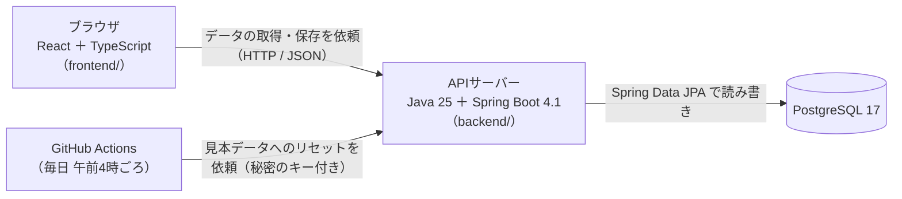

# 技術スタック：TaskBoard

| 項目 | 内容 |
|---|---|
| 版 | v2.0 |
| 更新日 | 2026-10-27 |
| 親ドキュメント | [要件定義書](要件定義書.md) |
| ステータス | 確定（バージョンはメジャー・マイナーまで決める。細かい版（パッチ）は、追加するときの最新を使う） |

> 💡 **このドキュメントの役割**
> どの部分を、どんな技術（とバージョン）で作るか、なぜそれを選んだかをまとめる。AIに実装を頼むときも、このドキュメントを渡せば、使う技術がブレない。
>
> **IDの見方**：F 機能・R 動作ルール・UC ユースケース（[機能一覧](機能一覧.md)）、N 非機能要件（[非機能要件](非機能要件.md)）、Q 決定事項（[要件定義書](要件定義書.md)）。
>
> ⚠️ **Spring Boot 4 の注意**：ネットの記事や AI の回答の多くは、ひとつ前の Spring Boot 3 向け。Boot 4 は部品の名前や設定が変わっているので、迷ったら公式ドキュメントで確かめる（10章）。

---

## 1. 決まった技術

### 1.1 決め方

- コースの指定：**バックエンドは Java ＋ Spring Boot、フロントエンドは React（Next.js は対象外）、データベースは PostgreSQL**（Q8）。
- それ以外は、この3つに合わせて選んだ。Tailwind CSS と Gradle はコースの推奨どおり（Q28）。
- データベースの読み書きは Spring Data JPA（Q25）、画面の言語は TypeScript（Q26）、フォルダ構成は1つのリポジトリに `backend/` と `frontend/` を並べる（Q27）。

### 1.2 一覧

**バックエンド（`backend/`）**

| 役割 | 技術 | バージョン | 選んだ理由 |
|---|---|---|---|
| 言語 | Java | 25（LTS） | コースの指定。長く使える最新の長期サポート版（LTS） |
| フレームワーク | Spring Boot | 4.1 系（ひな型は 4.1.2） | コースの指定。3.5 系は 2026年6月で無料サポートが終わったので、サポート中の 4.1 系（2027年7月まで）にする |
| ビルド | Gradle（Groovy で書く。Gradle Wrapper を使う） | 9 系（ひな型は 9.8.2） | コースの推奨。Wrapper（`./gradlew`）なので、Gradle 本体を別に入れなくてよい |
| Web（API） | Spring Web MVC（`spring-boot-starter-webmvc`） | Boot に合わせる | REST API を作る標準の部品 |
| DB の読み書き | Spring Data JPA（中身は Hibernate） | Boot に合わせる | 表を Java のクラスとして扱え、簡単な読み書きは SQL を書かずに済む。教材が多い（Q25） |
| DB のドライバ | PostgreSQL JDBC ドライバ | Boot に合わせる | PostgreSQL につなぐための部品 |
| マイグレーション | Flyway（`spring-boot-starter-flyway`） | Boot に合わせる | テーブルの作成・変更を SQL ファイルで管理し、何度でも同じ手順で作り直せる（N-28） |
| 入力チェック | Bean Validation（`spring-boot-starter-validation`） | Boot に合わせる | サーバー側の入力チェック（N-12） |
| API の説明書 | springdoc-openapi（Swagger UI） | 3.2 系 | API の一覧をブラウザで見て、その場で試せる。Boot 4.1 に対応する版 |
| 動作確認 | Spring Boot Actuator（health だけ公開） | Boot に合わせる | 公開先が「起動したか」を確かめるのに使う |
| 書き込みの回数制限 | Bucket4j | 実装のときに確定 | 1分に60回までの制限（N-13）。10KB の制限は自作のフィルタで行う |

**フロントエンド（`frontend/`）**

| 役割 | 技術 | バージョン | 選んだ理由 |
|---|---|---|---|
| 実行環境 | Node.js ＋ npm | 22（LTS） | インストール済み。Vite 8 と Vitest 5 の条件（22.12 以上）を満たす |
| 言語 | TypeScript | Vite のひな型に合わせる | 型があるので書き間違いに早く気づける。Java と同じく「型」を意識できる（Q26） |
| 画面 | React | 19 系 | コースの指定（Next.js は使わない） |
| 開発ツール | Vite（`react-ts` テンプレート） | 8 系 | 設定が少なく、起動が速い |
| 見た目 | Tailwind CSS（`@tailwindcss/vite`） | 4 系 | コースの推奨（Q28）。クラス名を書くだけで見た目を整えられる |
| D&D | @dnd-kit/core ＋ @dnd-kit/sortable | 6 系 ＋ 10 系 | カラムをまたぐ並び替えの例が多い。キーボード（N-19）とタッチ（F-24）にも対応できる |
| サーバーとのやりとり | TanStack Query | 5 系 | 「タブに戻ったら読み直す」（R-27）と「先に画面を変え、失敗したら戻す」（R-24）がそのまま作れる |
| 入力チェック | Zod | 追加するときの最新 | 画面側の入力チェックと、サーバーから届いたデータの形の確認 |

**データベース**

| 役割 | 技術 | バージョン | 選んだ理由 |
|---|---|---|---|
| データベース | PostgreSQL | 17 | コースの指定。PC にもう入っていて、2029年11月までサポートがある。最新は 18 だが、自分のPC・公開先・自動テスト（CI）を 17 にそろえる |

---

## 2. システム構成図



- 画面はデータベースに直接つながらず、必ず APIサーバーを通す（[DB設計](DB設計.md) の「方針」）。
- 「最後に開いていたボード」だけはブラウザ（localStorage）に保存する（F-04）。
- 開発中は、Vite の開発サーバー（http://localhost:5173）が `/api` で始まる依頼を APIサーバー（http://localhost:8080）へ中継する（proxy）。そのため、開発中は CORS の設定がいらない。

---

## 3. フォルダ構成

```
task-management-app/
├─ docs/            仕様書（このドキュメントなど）
├─ mock/            画面のモック（HTML・CSS・JavaScript）
├─ backend/         APIサーバー（Spring Boot）… ひな型を作成済み
│   ├─ build.gradle・settings.gradle・gradlew …  ビルドの設定と Gradle Wrapper
│   └─ src/main/
│       ├─ java/com/taskboard/
│       │   ├─ TaskBoardApplication.java   起動クラス（作成済み）
│       │   ├─ controller/   API の入口（URL ごとの受け付け）
│       │   ├─ service/      ルールと判断（R-xx の処理）
│       │   ├─ repository/   データベースの読み書き（Spring Data JPA）
│       │   ├─ entity/       テーブルに対応するクラス
│       │   ├─ dto/          API でやりとりするデータの形（record）
│       │   └─ config/       CORS などの設定
│       └─ resources/
│           ├─ application.properties   設定（作成済み）
│           └─ db/migration/            Flyway の SQL ファイル（例：V1__create_tables.sql）
└─ frontend/        画面（React）… これから作る
    └─ src/
        ├─ api/          サーバーとのやりとり（fetch と TanStack Query）
        ├─ features/     機能ごとの部品（board・task・label）
        ├─ components/   共通の部品（モーダル・ボタンなど）
        └─ lib/          日付の表示などの小さな道具
```

- `controller/` などのフォルダは、実装のときに作る（今はひな型だけ）。
- 呼び出しの向きは **controller → service → repository** の一方通行にする。画面に近い側が、データに近い側を呼ぶ。

---

## 4. 開発環境

| 道具 | 状態 | メモ |
|---|---|---|
| JDK 25（Homebrew の OpenJDK 25） | 入っている | `~/.zshrc` に `JAVA_HOME` と `PATH` を設定済み |
| Gradle | 入れなくてよい | `backend/` の `./gradlew` が自動で用意する |
| Node.js 22・npm | 入っている | |
| PostgreSQL 17（Homebrew） | 入っていて起動中 | 開発用 `taskboard_dev` とテスト用 `taskboard_test` を、これから作る（N-08） |
| エディタ | Cursor | Java の拡張機能（Extension Pack for Java など）を入れると、補完やエラー表示が効く |
| Docker | 入れない | 使わない（11章） |

**起動のしかた**

| 対象 | コマンド | 開く URL |
|---|---|---|
| APIサーバー | `cd backend` → `./gradlew bootRun` | http://localhost:8080 |
| 画面（作ってから） | `cd frontend` → `npm run dev` | http://localhost:5173 |

---

## 5. テスト・品質の道具

| 対象 | 道具 | すること |
|---|---|---|
| バックエンドの部品 | JUnit 5・Mockito | service などのルールを1つずつ確かめる |
| バックエンドの結合 | Spring Boot Test ＋ テスト用DB（`taskboard_test`） | API からデータベースまで通して確かめる。テストの前に TRUNCATE でデータを空にする |
| カバレッジ（バックエンド） | JaCoCo（0.8.14 以上。Java 25 に対応する版） | テストで実行されたコードの割合を測る |
| フロントの部品 | Vitest・React Testing Library | 画面の部品を1つずつ確かめる |
| フロントのテスト用サーバー | MSW | テストのときに、API の返事を作り物で返す |
| 画面を操作するテスト（E2E） | Playwright | 受け入れ条件（AC-xx）の手順を自動で操作する |
| 書き方をそろえる | ESLint・Prettier | フロントのコードの書き方と見た目をそろえる |
| 自動テスト（CI） | GitHub Actions（PostgreSQL 17 を一緒に起動する） | プッシュのたびにテストを動かす（設定は後で） |

- カバレッジ 80%（N-27）は、バックエンド（JaCoCo）とフロント（Vitest）の自動テストで測る。画面を操作するテスト（E2E）は数に入れない。

---

## 6. 公開先と毎日のリセット（候補。公開のステップで最終確認）

| 対象 | 候補 | 無料枠の主な条件 |
|---|---|---|
| 画面 | Render の Static Site | 無料。毎月の通信量とビルド時間に上限がある |
| APIサーバー | Render の Web Service（Docker で動かす） | 15分アクセスがないと休止し、次の起動に約1分。メモリは約512MB |
| データベース | Neon Free（PostgreSQL 17） | 0.5GB まで。5分で休止するが、接続すれば起き上がる。期限なし |
| 毎日のリセット | GitHub Actions の定期実行（UTC 19:00＝日本時間 午前4時） | 秘密キー付きでリセット API を呼ぶ。休止中のサーバーを起こす役目も兼ねる |

**分かっているリスクと対策**

- **Dockerfile が必要**：Render には Java 用の標準の実行環境がないので、Dockerfile で動かす。PC に Docker がないため、Dockerfile は公開のときまで試せない。
- **メモリが少ない**：Spring Boot には約512MB はぎりぎり。JVM のメモリ設定（`MaxRAMPercentage=75` など）、データベースの接続数（3〜5）、`spring.jpa.open-in-view=false` で節約する。
- **休止と起動待ち**：休止明けは数十秒〜1分かかる（N-03 で許容済み）。
- **リセットの遅れ**：GitHub Actions の定期実行は、数分〜数十分遅れることがある。また、公開リポジトリは60日間動きがないと止まる。呼び出しには、やり直しと長めの待ち時間を付ける（R-30、N-07）。
- **Neon への接続**：中継（PgBouncer）を通さない直接接続にし、`sslmode=require` を付け、Render と同じ地域を選ぶ。
- **Render の無料データベースは使わない**：30日で消えるため。

---

## 7. 日付と時刻の扱い

| データ | データベース | Java | API（JSON） | 画面 |
|---|---|---|---|---|
| 期限日 | `DATE` | `LocalDate` | `"2026-10-31"`（日付だけの文字列） | 文字列のまま扱い、`new Date("2026-10-31")` は使わない（時差で1日ずれることがある） |
| 作成・更新日時 | `TIMESTAMPTZ` | `OffsetDateTime` | 時差つきの日時の文字列 | 表示しない（今は使い道なし） |

- 「今日」（期限切れの判定・F-15、表示の年・R-11）は、**ブラウザの日付**で決める。
- 見本データの期限は、**リセットした日（日本時間）からの相対日付**（例：3日後）で入れる。固定の日付にすると、次の日から全部「期限切れ」になってしまうため（[DB設計](DB設計.md)）。

---

## 8. 環境変数

秘密の情報や、場所によって変わる値は、プログラムに書かず環境変数で渡す（N-15）。ファイル（`.env.example` など）は環境構築のときに作る。

| 名前（案） | 使う場所 | 中身 | 秘密か |
|---|---|---|---|
| `SPRING_DATASOURCE_URL` | backend | データベースの場所（`jdbc:postgresql://…`） | 公開先では秘密として扱う |
| `SPRING_DATASOURCE_USERNAME`・`SPRING_DATASOURCE_PASSWORD` | backend | データベースのユーザー名とパスワード | 秘密 |
| `TASKBOARD_RESET_SECRET` | backend ・ GitHub Actions | リセット API の秘密キー（N-14） | 秘密 |
| `TASKBOARD_ALLOWED_ORIGIN` | backend | API を呼んでよい画面の URL（CORS、N-16） | 秘密ではない |
| `VITE_API_BASE_URL` | frontend | 画面から見た API の URL | 秘密ではない |

- `VITE_` で始まる変数は、画面のプログラムに埋め込まれて**誰でも見られる**。秘密は入れない。
- Spring Boot は `.env` ファイルを自動では読まない。環境変数で渡すか、設定ファイルで読み込みを指定する。
- `.env` などの秘密のファイルは `.gitignore` に入れ、GitHub に上げない。

---

## 9. 非機能要件をどう満たすか

| ID | 内容 | 使う技術・やり方 |
|---|---|---|
| N-03 | 休止明けの起動待ちを許容 | 公開先の休止を受け入れる。起動したかは Actuator の health で確かめる |
| N-11 | SQL はプレースホルダで組み立てる | Spring Data JPA が値を埋め込む。文字列をつなげて SQL を作らない |
| N-12 | サーバー側の入力チェック | Bean Validation ＋ service でのルール確認（件数の上限・同じボードかなど） |
| N-13 | 書き込みの回数制限と 10KB 制限 | Bucket4j ＋ 送られてきた大きさを見る自作フィルタ（大きすぎたら 413 を返す） |
| N-14 | リセット機能の保護 | 秘密のヘッダーを `MessageDigest.isEqual` で比べる。POST だけ受け付ける |
| N-15 | 秘密は環境変数に | 8章 |
| N-16 | HTTPS と CORS | HTTPS は公開先が用意する。CORS は WebMvcConfigurer で `TASKBOARD_ALLOWED_ORIGIN` だけを許可する |
| N-17 | 内部情報をエラーに出さない | エラーは決まった形（ProblemDetail）と日本語のメッセージで返す（形は API設計で決める） |
| N-27 | カバレッジ 80% | JaCoCo（バックエンド）と Vitest（フロント） |
| N-28 | データベースの変更管理 | Flyway |
| N-30 | 費用0円 | 6章の無料枠 |

---

## 10. 実装で気をつけること

- **Boot 4 との違い**：Web の部品は `spring-boot-starter-webmvc`、Flyway は `spring-boot-starter-flyway` が必要など、Boot 3 から名前や設定が変わっている。JSON の変換には Jackson 3 を使う。古い記事どおりに書いて動かないときは、公式ドキュメントで確かめる。
- **値の変換**：`status`・`priority`・`color` は小文字の値（`todo` など）で保存する。Java の enum とは、変換の部品（AttributeConverter）でつなぐ。`boards.position`（SMALLINT）は Java の `Short` で受ける。
- **テーブルは Flyway が作る**：JPA は `spring.jpa.hibernate.ddl-auto=validate` にして、テーブルの形が合っているかだけを確かめる。JPA にテーブルを作らせない。
- **並び替えはまとめて1回**：D&D と整列は、移動元と移動先の順番（`position`）を1つのトランザクションで振り直す（UC-04）。
- **まとめて読む**：ボードを開くときは、タスクとラベルをまとめて読み、1件ずつ何度も問い合わせない（N+1 問題を避ける）。
- **見本データ**：Flyway には入れず、Java の1つの部品にまとめる。初回起動と毎日のリセット（F-55）で同じものを使う。

---

## 11. 使わないもの

| 使わないもの | 理由 |
|---|---|
| Next.js | コースの指定で対象外 |
| Spring Security | ログインがない。CORS とリセットの秘密キーは、それぞれの仕組みで足りる |
| Testcontainers（Docker） | PC に Docker がない。代わりにローカルのテスト用データベースを使う |
| Lombok | 学習のため、Java の基本の書き方を使う。API のデータの形は record で短く書ける |
| Spring の `@Scheduled`（定時実行） | 無料の公開先は休止中に動かない。毎日のリセットは GitHub Actions から呼ぶ |
| Redux・React Router | 画面は1ページだけ。サーバーのデータは TanStack Query で持つ |
| Render の無料データベース | 30日で消える。Neon を使う |

---

## 12. 変更履歴

| 版 | 日付 | 内容 |
|---|---|---|
| v1.0 | 2026-10-20 | 要件定義書 v2.0 の「技術構成（方針）」と「システム構成図」を移して作成。技術選定で決めることと、関係する非機能要件の一覧を追加 |
| v2.0 | 2026-10-27 | コースの指定（Java＋Spring Boot、React、PostgreSQL）を受けて技術を確定。バージョンと選んだ理由、フォルダ構成、開発環境、テストの道具、公開先の候補とリスク、日付と時刻の扱い、環境変数、非機能要件との対応、実装の注意、使わないものを追加 |
