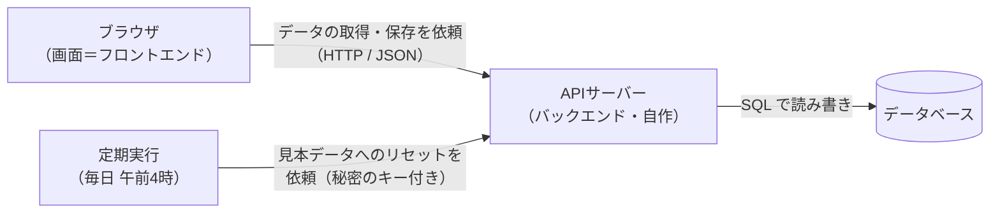

# 技術スタック：TaskBoard

| 項目 | 内容 |
|---|---|
| 版 | v1.0 |
| 更新日 | 2026-10-20 |
| 親ドキュメント | [要件定義書](要件定義書.md) |
| ステータス | 方針のみ（具体的な技術は「技術選定」のステップで決める） |

> 💡 **このドキュメントの役割**
> どの部分を、どんな技術で作るかをまとめる。今は決まっている方針と候補だけを書き、技術選定のステップで確定させる。コースでの技術指定はない（Q8）。
>
> **IDの見方**：F 機能（[機能一覧](機能一覧.md)）、N 非機能要件（[非機能要件](非機能要件.md)）、Q 決定事項（[要件定義書](要件定義書.md)）。

---

## 1. 方針と候補

| 部分 | 方針 | 候補 |
|---|---|---|
| フロントエンド | ブラウザで動く画面 | React + TypeScript + Vite（v1 の推奨案） |
| D&D | ライブラリを使う | dnd-kit／Pragmatic drag and drop（Trelloの運営元 Atlassian 製） |
| バックエンド | 自作の APIサーバー | 言語・フレームワークは技術選定で決める（例：Node.js + TypeScript、Java + Spring Boot など） |
| データベース | 表の形で保存するデータベース（リレーショナルDB） | PostgreSQL を想定（[DB設計](DB設計.md) の型はこれで書いている） |
| 定期実行 | 毎日午前4時のリセット（F-55） | 公開先の定期実行機能など |
| 公開先 | 画面・APIサーバー・データベースをそれぞれ公開する | 無料枠のあるサービスから選ぶ |
| テスト | 部品単位のテストと、画面を操作するテスト | 画面を操作するテストは Playwright を想定 |

---

## 2. システム構成図

- 画面はデータベースに直接つながらず、必ず APIサーバーを通す（[DB設計](DB設計.md) の「方針」）。
- 「最後に開いていたボード」だけはブラウザ（localStorage）に保存する（F-04）。

---

## 3. 技術選定で決めること

| No | 決めること | 関係する要件 |
|---|---|---|
| 1 | バックエンドの言語・フレームワーク | Q18 |
| 2 | データベースの種類（PostgreSQL で確定するか） | [DB設計](DB設計.md) |
| 3 | データベースの作成・変更を管理する道具（マイグレーション） | N-28 |
| 4 | D&D ライブラリ（dnd-kit か Pragmatic drag and drop か） | F-20〜F-24 |
| 5 | 画面・APIサーバー・データベースの公開先 | N-16, N-30 |
| 6 | 毎日のリセットを動かす仕組み | F-55, N-14 |
| 7 | 部品単位のテストの道具 | N-27 |

---

## 4. 技術に関係する非機能要件

技術を選ぶときは、[非機能要件](非機能要件.md) のうち次の項目を満たせるかを確認する。

| ID | 内容 |
|---|---|
| N-03 | 無料の公開先は休止からの起動に数十秒かかることがある（許容する） |
| N-11 | SQL はプレースホルダ（パラメータ化クエリ）で組み立てる |
| N-13 | 書き込みの回数制限と、1回に送れるデータの大きさの制限 |
| N-14 | リセット機能は秘密のキーがないと動かせない |
| N-15 | 秘密の情報は環境変数に入れ、Git に含めない |
| N-16 | HTTPS と CORS（自分の画面からの依頼だけ受け付ける） |
| N-27 | 自動テストのカバレッジ80%以上 |
| N-28 | データベースの変更はマイグレーションで管理する |
| N-30 | 費用0円（無料枠） |

---

## 5. 変更履歴

| 版 | 日付 | 内容 |
|---|---|---|
| v1.0 | 2026-10-20 | 要件定義書 v2.0 の「技術構成（方針）」と「システム構成図」を移して作成。技術選定で決めることと、関係する非機能要件の一覧を追加 |
