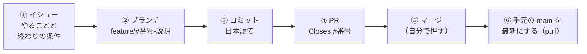

# 技術スタック：開発ツール

| 項目 | 内容 |
|---|---|
| 版 | v1.0 |
| 更新日 | 2026-11-19 |
| 親ドキュメント | [技術スタック](../技術スタック.md) |
| ステータス | 開発環境は準備済み。E2E テストと自動テスト（CI）はこれから |

> 💡 **このドキュメントの役割**
> アプリそのものには入らないが、作るときに使う道具（エディタ・AI・Git・テスト・書き方の点検など）をまとめる。開発環境の準備と起動のしかたもここにある。
> 「最新版」は npm・Maven Central の公式サイトで 2026-11-19 に確かめた版。
>
> **記号**：✅ 最新／🔼 新しい版がある（上げてよい）／⏸ 新しい版があるが、理由があって今は上げない／⏳ まだ入れていない

---

## 1. 開発に使う道具

| 役割 | 道具 | 入っている版 | 使い方・メモ |
|---|---|---|---|
| エディタ | Cursor | — | VS Code と同じ使い方ができる。左下にブランチ名（`main` など）が出ていれば、Git とつながっている |
| AI | Claude Code（Cursor の拡張機能） | — | 相談・資料作り・実装・テスト・Git の操作を任せる。守るルールは [CLAUDE.md](../../CLAUDE.md) |
| バージョン管理 | Git | 2.54.0 | 変更の記録（commit）とブランチ |
| リポジトリの置き場所 | GitHub（`fujiengineering21-png/task-management-app`） | — | イシュー・PR・マージ |
| GitHub の操作 | GitHub CLI（`gh`） | 2.88.1 | イシューと PR をコマンドで作る。操作の前に、使っているアカウントが `fujiengineering21-png` かを確かめる（CLAUDE.md のルール7） |
| コンテナ | Docker Desktop ＋ Docker Compose | 29.9.2・5.6.1 | 開発用のデータベースを動かす（[データベース](データベース.md)） |
| Node.js の版の管理 | nvm | — | Node.js 22 を使う（`~/.nvm`）。[フロントエンド](フロントエンド.md) |
| Java の入手 | Homebrew（`openjdk@25`） | — | `~/.zshrc` に `JAVA_HOME` と `PATH` を設定済み。[バックエンド](バックエンド.md) |

### 1.1 Cursor の拡張機能

| 拡張機能 | 状態 | 何に使うか |
|---|---|---|
| Claude Code | 入っている | AI に相談・作業を頼む |
| Japanese Language Pack | 入っている | メニューを日本語にする |
| Markdown Preview Enhanced | 入っている | `docs/` の資料を見やすく表示する。`.md` を開いて `Cmd + K` → `V` で横に表示 |
| Extension Pack for Java | 入れるとよい | Java の補完やエラー表示が効く |
| ESLint・Prettier | 入れるとよい | 保存のときに書き方の点検と見た目の整えができる |
| Tailwind CSS IntelliSense | 入れるとよい | Tailwind のクラス名の補完が効く |

---

## 2. テストと品質の道具

### 2.1 バックエンド（`backend/`）

| 役割 | 道具 | 入っている版 | 最新版 | すること |
|---|---|---|---|---|
| テストの土台 | JUnit Jupiter（JUnit 5 の仕組み） | 6.0.3 | Spring Boot が決める | テストを書いて実行する |
| 作り物の部品 | Mockito | 5.23.0 | Spring Boot が決める | データベースなどを作り物に置き換えて、service のルールだけを確かめる |
| 結果の確認 | AssertJ | 3.27.7 | Spring Boot が決める | 「こうなるはず」を読みやすく書く |
| API のテスト | Spring Boot Test（`@WebMvcTest`） | Boot 4.1.2 | — | サーバーを起動せずに、API の入口（controller）を確かめる |
| カバレッジ | JaCoCo | ⏳ | 0.8.16 | テストで実行されたコードの割合を測る（N-27） |
| データベースまで通すテスト | Spring Boot Test ＋ テスト用DB（`taskboard_test`） | ⏳ | — | API からデータベースまで通して確かめる。テストの前に TRUNCATE でデータを空にする |

- 今あるテストは、service（Mockito）と controller（`@WebMvcTest`）と値の変換。データベースを使わないので、Docker が止まっていても実行できる。

### 2.2 フロントエンド（`frontend/`）

| 役割 | 道具 | 入っている版 | 最新版 | すること |
|---|---|---|---|---|
| テストの実行 | Vitest | 5.1.0 | 5.1.1 🔼 | 部品や関数のテストを実行する |
| カバレッジ | @vitest/coverage-v8 | 5.1.0 | 5.1.1 🔼 | 80% を下回ると失敗にする（N-27） |
| 画面の部品のテスト | React Testing Library（@testing-library/react・dom） | 16.3.3・10.4.2 | 16.3.3・10.4.2 ✅ | 使う人と同じ目線（表示された文字やボタン）で確かめる |
| 画面の確認の道具 | @testing-library/jest-dom | 7.0.1 | 8.0.0 🔼（大きな版。変更点を確かめてから） | 「表示されている」などを書ける |
| 操作のまね | @testing-library/user-event | 14.6.9 | 14.6.13 🔼 | クリックや文字の入力をまねる |
| テスト用のブラウザ | jsdom | 29.1.1 | 31.0.1 🔼（大きな版。変更点を確かめてから） | ブラウザがなくても画面のテストができる |
| 作り物の API | MSW | 3.0.5 | 3.0.7 🔼 | テストのときに API の返事を作り物で返す。用意していない URL への通信は失敗にする |
| 画面を操作するテスト（E2E） | Playwright | ⏳ | 1.65.1 | 受け入れ条件（AC-xx）の手順を、本物のブラウザで自動で操作する |

### 2.3 書き方をそろえる道具（フロントエンド）

| 役割 | 道具 | 入っている版 | 最新版 | すること |
|---|---|---|---|---|
| 書き方の点検 | ESLint（＋ @eslint/js） | 10.14.0（10.0.1） | 10.15.0 🔼（10.0.1 ✅） | 間違いやすい書き方を見つける |
| TypeScript の点検 | typescript-eslint | 8.72.2 | 8.73.0 🔼 | 型を使った点検。TypeScript 6.1 未満にしか対応していない（[フロントエンド](フロントエンド.md) の2.2） |
| React の点検 | eslint-plugin-react-hooks・eslint-plugin-react-refresh | 7.1.1・0.5.7 | 7.1.1 ✅・0.5.8 🔼 | フック（`useState` など）の正しい使い方を確かめる |
| 見た目をそろえる | Prettier（＋ eslint-config-prettier） | 3.9.10（10.1.8） | 3.10.1 🔼（10.1.8 ✅） | 字下げ・引用符などを自動でそろえる。セミコロンなし・シングルクォート・1行100文字 |

### 2.4 自動テスト（CI）

| 道具 | 状態 | すること |
|---|---|---|
| GitHub Actions（PostgreSQL 17 を一緒に起動する） | ⏳ | プッシュのたびにテストを自動で動かす。公開のステップで、毎日のリセットにも使う |

- カバレッジ 80%（N-27）は、バックエンド（JaCoCo）とフロントエンド（Vitest）の自動テストで測る。画面を操作するテスト（E2E）は数に入れない。

---

## 3. 開発環境の準備（最初の1回だけ）

1. Docker Desktop を入れて、開いておく。
2. リポジトリ直下で `cp .env.example .env` を実行し、`.env` の `POSTGRES_PASSWORD` を自分だけの値に変える（英数字と `_` だけ）。
3. `frontend/` で `npm ci` を実行して、画面の部品を入れる。
4. Java 25 が使えるか確かめる（`java -version`）。Gradle は `./gradlew` が自動で用意するので、入れなくてよい。

---

## 4. 起動のしかた

上から順に起動する。ポートの番号は変えない（[CLAUDE.md](../../CLAUDE.md) のルール6）。

| 順番 | 対象 | 場所 | コマンド | ポート | 開く URL |
|---|---|---|---|---|---|
| 1 | データベース | リポジトリ直下 | `docker compose up -d` | 5433 | （画面はない） |
| 2 | APIサーバー | `backend/` | `./gradlew bootRun` | 8080 | http://localhost:8080/actuator/health |
| 3 | 画面 | `frontend/` | `npm run dev` | 5173 | http://localhost:5173 |

- **止めるとき**：画面と APIサーバーはターミナルで `Ctrl + C`。データベースは `docker compose stop`（データは残る）。
- **開けるのはこの PC からだけ**：APIサーバー・データベース・画面は、同じ Wi-Fi の他の機器（スマホなど）からは開けない。ログインのない開発中のサーバーを、カフェなどの Wi-Fi で他人に触られないようにするため。
- Claude Code に起動を頼むと、決まったポートで起動する手順（`.claude/skills/start-servers/SKILL.md`）にしたがって起動する。

---

## 5. 開発の進め方（GitHub の使い方）

[CLAUDE.md](../../CLAUDE.md) のルールにしたがって、次の順で進める。

| 決まり | 内容 |
|---|---|
| main へ直接プッシュしない | main の上でコミットしない。プッシュするのは作業ブランチだけ |
| コミットメッセージ | `<種類>: <日本語の説明>`（例：`feat: 画面のひな型を追加する`）。種類は feat・fix・docs・refactor・test・chore |
| マージ | PR のマージは自分で行う。Claude はマージしない |
| マージのあと | `git switch main` → `git pull` で手元の main を最新にする。マージ後は push ではなく **pull** |

### 5.1 Claude Code の設定（`.claude/`）

| ファイル | GitHub に上げるか | 内容 |
|---|---|---|
| `settings.json` | 上げる（全員共通） | 確認なしで実行してよいコマンド（許可リスト）と、実行させないコマンド（拒否リスト：ファイルの削除、`git reset`、ブランチの削除、ポート番号の変更など） |
| `settings.local.json` | 上げない（`.gitignore` で除外） | 自分の PC だけの設定 |
| `skills/start-servers/SKILL.md` | 上げる | サーバーを決まったポートで起動・停止する手順 |

---

## 6. 気をつけること

- **iCloud の同期**：このリポジトリは iCloud Drive の「書類」フォルダにある。`node_modules/` は部品の数が多く、同期に時間がかかったり、同期の途中で壊れたりすることがある。
  - 対策は、`node_modules.nosync` という名前のフォルダに部品を置き、`node_modules` をそこへのリンク（シンボリックリンク）にすること（名前が `.nosync` で終わるものは iCloud が同期しない）。
  - ⚠️ 2026-11-19 の時点では、`node_modules` はふつうのフォルダのままで、`node_modules.nosync` は空になっている（まだ対策が効いていない）。
- **Git の操作が遅いとき**：iCloud の同期中は、`git status` などに時間がかかることがある。少し待ってからやり直す。

---

## 7. 変更履歴

| 版 | 日付 | 内容 |
|---|---|---|
| v1.0 | 2026-11-19 | [技術スタック](../技術スタック.md) v2.4 の「開発環境」と「テスト・品質の道具」を移して作成。エディタ・AI・Git・GitHub の道具、テストと書き方の点検の道具の入っている版と最新版、開発の進め方、Claude Code の設定、iCloud の注意を追加 |
