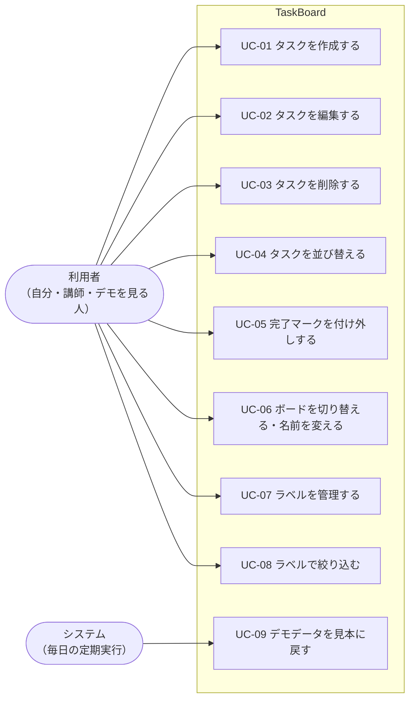
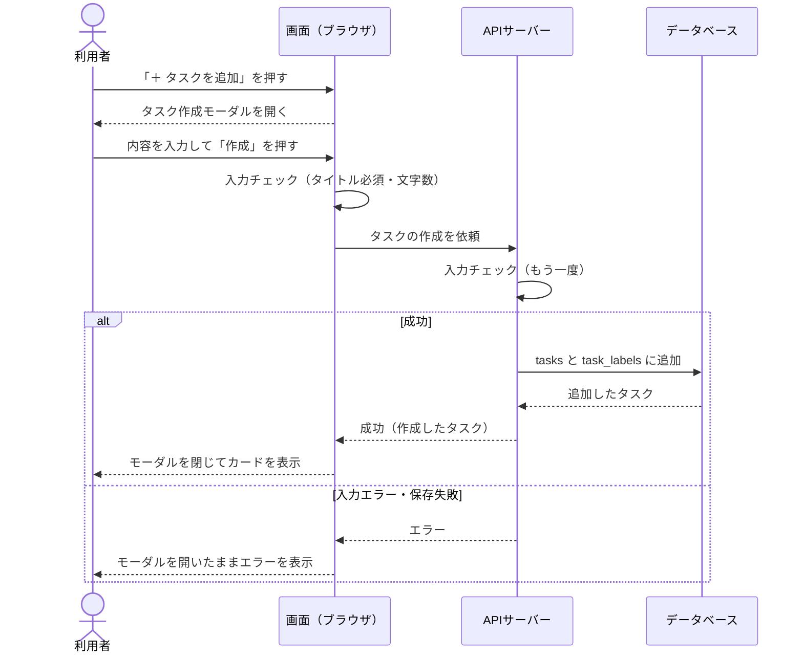
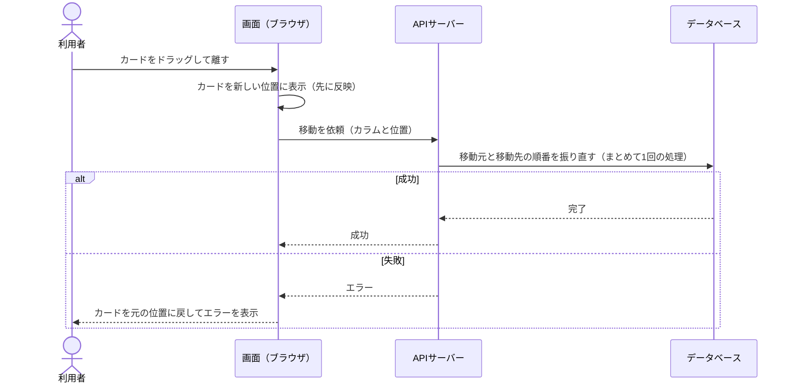

# 機能一覧（機能要件）：TaskBoard

| 項目 | 内容 |
|---|---|
| 版 | v1.2 |
| 更新日 | 2026-10-27 |
| 親ドキュメント | [要件定義書](要件定義書.md) |

> 💡 **このドキュメントの役割**
> 「ユーザーが何をできるか」と、そのときの細かい動き・操作の流れ・完成の判定基準をまとめる。
> 画面の項目は [画面設計](画面設計.md)、保存するデータの形は [DB設計](DB設計.md) を見る。
>
> **IDの見方**：F 機能／R 動作ルール／UC ユースケース／AC 受け入れ条件（このドキュメント）、S 画面（[画面設計](画面設計.md)）、N 非機能要件（[非機能要件](非機能要件.md)）、Q 決定事項（[要件定義書](要件定義書.md)）。

---

## 1. 機能一覧

> 💡 IDを振っておくと、後で「F-10 を実装して」とAIに指示できる。優先度の意味（Must／Should／Could）は [要件定義書](要件定義書.md) の「スコープ」を見る。

### 1.1 ボード・カラム

| ID | 機能 | 優先度 | 詳細 |
|---|---|---|---|
| F-01 | ボード表示 | Must | 選んでいるボードの3カラム（未着手／作業中／完了）を横並びで表示する |
| F-02 | ボード切り替え | Must | 画面上部のタブで「仕事」「プライベート」を切り替える。タスク・ラベルはボードごとに別々 |
| F-03 | ボード名の変更 | Must | タブの名前をダブルクリックして変更する（キーボードではタブを選んで F2 キー）。1〜20文字。初期名は「仕事」「プライベート」 |
| F-04 | 前回のボードを開く | Should | 次に開いたとき、そのブラウザで最後に見ていたボードを表示する（この情報だけはブラウザに保存する。[DB設計](DB設計.md)「ブラウザに保存するもの」参照） |
| F-05 | カラムの件数表示 | Should | カラム見出しに件数を出す（例：「作業中 (3)」） |
| F-06 | カラムの追加・名前変更・削除 | Could | 今回はカラムを3つの固定値（todo／doing／done）で管理する。追加するときはカラム用のテーブルを新しく作る |

- ボードは2つで固定。追加・削除はできない（Q5）。

### 1.2 タスク

| ID | 機能 | 優先度 | 詳細 |
|---|---|---|---|
| F-10 | タスク作成 | Must | 各カラム下の「＋ タスクを追加」を押すとタスク作成モーダル（S-02）が開く。タイトル・説明・カラム・優先度・期限・ラベルをまとめて入力し、「作成」で保存する（Q20） |
| F-11 | タスク編集 | Must | カードをクリックするとタスク編集モーダル（S-03）が開く。作成と同じ項目を編集でき、「保存」で反映、「キャンセル」で破棄する（Q14） |
| F-12 | タスク削除 | Must | 編集モーダルの「削除」から削除確認ダイアログ（S-04）を出し、「削除する」で削除する |
| F-13 | 優先度 | Should | 高／中／低／なし から選ぶ。カード上に表示 |
| F-14 | 期限日 | Should | カレンダーから日付を選ぶ。カード上に表示 |
| F-15 | 期限切れ・期限当日の強調 | Could | 期限切れは赤、当日は黄色で表示 |

- タスクは作ったボードに属する。もう一方のボードへは移動できない（Q13）。

### 1.3 ドラッグ＆ドロップ・並び替え

| ID | 機能 | 優先度 | 詳細 |
|---|---|---|---|
| F-20 | カラム間の移動 | Must | カードをつかんで、同じボードの別のカラムへ移動する |
| F-21 | カラム内の並び替え | Must | 同じカラムの中で上下の順番を入れ替える |
| F-22 | ドラッグ中の見た目 | Should | つかんだカードに影を付け、落とす位置にガイドを出す |
| F-23 | 整列ボタン | Should | カラム見出しの「⋯」メニューから「優先度順」「期限順」を選ぶと、そのカラムのタスクを並べ直す（ルールは下記） |
| F-24 | タッチ操作 | Could | スマホ・タブレットの指でも D&D できる |

**整列のルール（F-23）**

| 整列 | 並ぶ順番 | 同じ値のとき |
|---|---|---|
| 優先度順 | 高 → 中 → 低 → なし | 期限の早い順 |
| 期限順 | 期限の早い順。期限なしは一番下 | 優先度の高い順 |

- 整列は「その場で1回並べ直す」ボタン。並べ直した順番は保存され、そのあとも D&D で自由に動かせる（Q9）。
- チェック済みのタスクは、上のルールに関係なく一番下にまとめる（その中の順番は同じルール）（Q15）。

### 1.4 チェック（完了マーク）

| ID | 機能 | 優先度 | 詳細 |
|---|---|---|---|
| F-30 | チェックの付け外し | Must | カード左側の丸いチェックボックスをクリックして切り替える。どのカラムにあっても付けられる |
| F-31 | チェック済みの見た目 | Must | ✓ を表示し、タイトルに取り消し線を引き、カード全体を少し薄くする |
| F-32 | チェックとカラムは連動しない | Must | チェックしてもカードは移動しない。「完了」へ移動してもチェックは自動で付かない（Q2） |
| F-33 | チェック済みタスクの一括アーカイブ | Could | ✓ の付いたタスクをまとめてボードから片付ける |

### 1.5 ラベル（色分け）

| ID | 機能 | 優先度 | 詳細 |
|---|---|---|---|
| F-40 | ラベルの付け外し | Must | 作成・編集モーダルでラベルを選ぶ。1つのタスクに複数付けられる（Q3） |
| F-41 | ラベルの色 | Must | 決められた6色（緑・黄・オレンジ・赤・紫・青）から選ぶ |
| F-42 | ラベル名 | Must | ラベルに名前を付けられる（例：赤＝「緊急」）。名前なしでもよい |
| F-43 | ラベルの作成・編集・削除 | Must | ラベル管理モーダル（S-05）で、いま開いているボードのラベルを管理する。ラベルを削除すると、付いていたタスクからも外れる |
| F-44 | ラベルで絞り込み | Should | ラベルを複数選べ、どれか1つでも付いているタスクを表示する（Q16） |
| F-45 | 見本のラベル | Must | 見本データとして、各ボードに名前付きのラベルを6色用意しておく（中身は [DB設計](DB設計.md)「見本データ」） |

- ラベルはボードごとに別々に持つ。「仕事」ボードのラベルは「プライベート」ボードには出てこない（Q12）。

### 1.6 データ保存・公開デモ

| ID | 機能 | 優先度 | 詳細 |
|---|---|---|---|
| F-50 | データベースへの保存 | Must | 変更するたびに APIサーバー経由でデータベースに保存する。モーダル以外に保存ボタンは置かない（Q18） |
| F-51 | 最新データの読み込み | Must | 画面を開いたとき、およびブラウザのタブに戻ってきたとき、サーバーから最新のデータを読み込む |
| F-52 | 読み込み中・接続エラーの表示 | Must | 読み込み中は「読み込み中」を表示する。サーバーにつながらないときはエラーと「再読み込み」ボタンを表示する |
| F-53 | 保存失敗の通知 | Must | 保存できなかったら画面にエラーを表示する（動きは R-24、R-25） |
| F-54 | 公開デモの案内表示 | Must | 画面上部に「公開デモです。誰でも編集でき、毎日午前4時に見本データへ戻ります。個人情報や本物の予定は入力しないでください」と常に表示する |
| F-55 | 見本データへの毎日のリセット | Must | 毎日午前4時（日本時間）に、すべてのデータを消して見本データに戻す（Q21） |

### 1.7 その他

| ID | 機能 | 優先度 | 詳細 |
|---|---|---|---|
| F-60 | キーワード検索 | Could | 開いているボードの中で、タイトル・説明の文字でタスクを絞り込む |
| F-61 | ダークモード | Could | 暗い配色に切り替える |

---

## 2. 細かい動作ルール

> 💡 実装中に「この場合どうする？」となりやすい細かい動きを、先に決めておく。ここが空いていると、実装後の手直しの原因になる。

**タスクの作成・編集**

| ID | 場面 | ルール |
|---|---|---|
| R-01 | 作成する位置 | 新しいタスクは、作成モーダルで選んだカラムの一番下に入る |
| R-02 | 作成モーダルの初期値 | 「＋ タスクを追加」を押したカラムが「カラム」欄に最初から入っている。ほかの項目は空（優先度・期限・ラベルは「なし」、チェックなし） |
| R-03 | モーダルの閉じ方 | 「作成」「保存」で反映して閉じる。「キャンセル」・×ボタン・Esc で閉じると入力内容は破棄。モーダルの外をクリックしても閉じない（誤操作で消えるのを防ぐ）。タイトルが空のときは「作成」「保存」を押せない（Q14） |
| R-04 | 編集でカラムを変えたとき | 編集モーダルで「カラム」を変えて保存すると、移動先カラムの一番下に入る（D&D が使えない人のための代わりの手段にもなる） |
| R-05 | 入力の空白 | 前後の空白は取り除いて保存する。空白だけのタイトルは「空」として扱う |
| R-06 | 文字数の上限 | タイトル100文字・説明1000文字・ラベル名20文字・ボード名20文字。上限に達したら、それ以上は入力できない |
| R-07 | 説明文 | ただの文章として表示する（改行はそのまま）。太字などの装飾（Markdown）は使えない |

**カードの見た目**

| ID | 場面 | ルール |
|---|---|---|
| R-08 | カードに出す情報 | 上から「ラベル」「チェックボックス＋タイトル」「優先度・期限・説明ありマーク（📝）」。設定していないものは出さない |
| R-09 | ラベルの表示 | 色＋名前で表示する。名前のないラベルは色だけの帯で表示する |
| R-10 | 長いタイトル | 省略せず、折り返して全文を表示する |
| R-11 | 期限日 | 日付だけ（時刻はなし）。過去の日付も選べる。表示は「9/30」、今年以外は「2027/1/15」。あとから消すこともできる |

**チェック・削除**

| ID | 場面 | ルール |
|---|---|---|
| R-12 | チェックの操作 | カードを開かずに付け外しできる。チェックボックスを押しても編集モーダルは開かない |
| R-13 | タスクの削除 | 確認ダイアログに「このタスクを削除しますか？元に戻せません」とタスク名を出す。削除したタスクは元に戻せない |

**ドラッグ＆ドロップ・整列**

| ID | 場面 | ルール |
|---|---|---|
| R-14 | 空のカラム | タスクが1件もないカラムにもドロップできる |
| R-15 | ドロップ失敗 | カラムの外で手を離したら、カードは元の位置に戻る |
| R-16 | 整列の範囲 | 整列は、メニューを開いたカラムだけに対して行う |

**ラベル・絞り込み**

| ID | 場面 | ルール |
|---|---|---|
| R-17 | ラベルの数 | 1つのボードに最大20個。同じ色で複数作れる（例：赤「緊急」と赤「至急」）。ただし色も名前も同じラベルは作れない |
| R-18 | ラベルの削除 | 確認ダイアログ（S-06）に「このラベルは n 件のタスクから外れます」と出す |
| R-32 | ラベルの色・名前の保存 | ラベル管理（S-05）では保存ボタンを置かず、変えるとすぐ保存する。色は選んだとき、名前は Enter を押したときか欄から離れたときに保存。失敗したら、その欄だけ元の値に戻してエラーを出す。ほかの欄で入力中の文字は消さない（Q22） |
| R-19 | 絞り込みの条件 | 何も選んでいないときは全部表示。複数選んだら、どれか1つでも付いているタスクを表示（Q16） |
| R-20 | 絞り込み中にできること | カードの表示・チェック・編集はできる。D&D・整列・タスクの作成はできない（隠れているタスクとの順番が決められないため）。絞り込み中であることを画面に表示する |
| R-21 | 絞り込み中の件数 | 「作業中 (2/5)」のように「表示中の件数／全体の件数」を出す |
| R-22 | 絞り込みの解除 | ボードを切り替えたとき、再読み込みしたときに解除する（絞り込み状態は保存しない） |

**ボード**

| ID | 場面 | ルール |
|---|---|---|
| R-23 | ボード名の変更 | ダブルクリックで入力欄になる。キーボードでは、タブを選んで F2 キーでも入力欄になる（Q23）。Enter で確定、Esc で取り消し。空のまま確定したら元の名前に戻る。もう一方のボードと同じ名前にはできない。キーボードで確定・取り消ししたら、そのタブにフォーカスを戻す |

**保存・通信**

| ID | 場面 | ルール |
|---|---|---|
| R-24 | 保存のタイミング（2種類） | **D&D・チェック・整列**：先に画面を変え、裏でサーバーに保存する。失敗したら元に戻してエラーを出す（操作が軽く感じられるようにするため）。**それ以外**（作成・編集・削除・ラベル・ボード名）：サーバーの成功を待ってから画面に反映する。待っている間はボタンを押せない（二重登録を防ぐ） |
| R-25 | エラーの表示 | 画面上部に赤いメッセージを数秒出す。モーダルで失敗したときは、モーダルを開いたままエラーを出し、入力内容は残す |
| R-26 | サーバーにつながらないとき | 画面に「サーバーに接続できません」と「再読み込み」ボタンを出す |
| R-27 | 他の人・他のタブの変更 | 自動では反映しない。ブラウザのタブに戻ってきたとき、または再読み込みしたときに最新を読み込む。同じタスクを同時に変えたら、後から保存したほうが残る |
| R-28 | 他の人が削除したタスクを操作したとき | 「このタスクはすでに削除されています」と出し、ボードを読み込み直す |
| R-29 | タスクの上限 | 1つのボードに最大200件。超えて作成しようとしたら「これ以上タスクを作成できません」と出す（公開デモでデータが増えすぎるのを防ぐ） |

**公開デモ**

| ID | 場面 | ルール |
|---|---|---|
| R-30 | 毎日のリセット | 毎日午前4時（日本時間）に、すべてのタスク・ラベル・ボード名を消して見本データに戻す。リセット中に操作した人にはエラーを出し、ボードを読み込み直す。定期実行の仕組み上、数分〜数十分遅れることがある（[技術スタック](技術スタック.md) の「公開先と毎日のリセット」） |
| R-31 | 画面の言葉 | 日本語のみ |

---

## 3. ユースケース・操作フロー

> 💡 「誰が・何をするか」（ユースケース）と、そのとき画面・サーバー・データベースの間で何が起きるか（操作フロー）を書く。実装やテストのときの手順書になる。

### 3.1 ユースケース一覧

| ID | ユースケース | 関係する機能 | 詳しい流れ |
|---|---|---|---|
| UC-01 | タスクを作成する | F-10 | 3.2 |
| UC-02 | タスクを編集する | F-11, F-13, F-14, F-40 | 3.3 |
| UC-03 | タスクを削除する | F-12 | 3.4 |
| UC-04 | タスクを並び替える（D&D・整列） | F-20〜F-23 | 3.5 |
| UC-05 | 完了マークを付け外しする | F-30〜F-32 | F-30〜F-32 と R-12、R-24 のとおり |
| UC-06 | ボードを切り替える・名前を変える | F-02〜F-04 | F-02〜F-04 と R-23 のとおり |
| UC-07 | ラベルを管理する | F-41〜F-43 | F-41〜F-43 と R-17、R-18、R-32 のとおり |
| UC-08 | ラベルで絞り込む | F-44 | R-19〜R-22 のとおり |
| UC-09 | デモデータを見本に戻す | F-55 | R-30 のとおり |

### 3.2 UC-01 タスクを作成する

| 項目 | 内容 |
|---|---|
| 利用者 | 利用者 |
| 始める前の状態 | ボード画面（S-01）が表示されている。絞り込みをしていない |
| 終わった後の状態 | 新しいタスクがデータベースに保存され、選んだカラムの一番下に表示されている |

**基本の流れ**

1. 利用者が、カラム下の「＋ タスクを追加」を押す
2. 画面が、タスク作成モーダル（S-02）を開く。「カラム」欄には押したカラムが入っている（R-02）
3. 利用者が、タイトル（必須）と、必要なら説明・カラム・優先度・期限・ラベルを入力し、「作成」を押す
4. 画面が入力内容をチェックし、サーバーに作成を依頼する。待っている間は「作成」を押せない
5. サーバーが入力内容をもう一度チェックし、データベースの `tasks`（と `task_labels`）に保存する
6. 画面が、モーダルを閉じて、カラムの一番下にカードを表示する

**うまくいかないときの流れ**

| 起きること | 動き |
|---|---|
| タイトルが空 | 「作成」が押せない（3で止まる） |
| ボードのタスクが200件ある | 「これ以上タスクを作成できません」と出す（R-29） |
| サーバーにつながらない・保存に失敗 | モーダルを開いたままエラーを出す。入力内容は残る（R-25） |
| 「キャンセル」・×・Esc | 何も保存せずにモーダルを閉じる |

### 3.3 UC-02 タスクを編集する

| 項目 | 内容 |
|---|---|
| 利用者 | 利用者 |
| 始める前の状態 | ボード画面に編集したいタスクのカードが表示されている |
| 終わった後の状態 | 変更した内容がデータベースに保存され、カードに反映されている |

**基本の流れ**

1. 利用者が、カードをクリックする
2. 画面が、タスク編集モーダル（S-03）を開き、今の内容を表示する
3. 利用者が、内容を書き換えて「保存」を押す
4. 画面が入力内容をチェックし、サーバーに更新を依頼する
5. サーバーが入力内容をもう一度チェックし、データベースを更新する（カラムを変えた場合は移動先の一番下に入れる：R-04）
6. 画面が、モーダルを閉じてカードの表示を更新する

**うまくいかないときの流れ**

| 起きること | 動き |
|---|---|
| タイトルを空にした | 「保存」が押せない |
| 「キャンセル」・×・Esc | 変更を捨ててモーダルを閉じる。カードは元のまま |
| 他の人がすでに削除していた | 「このタスクはすでに削除されています」と出し、ボードを読み込み直す（R-28） |
| サーバーにつながらない・保存に失敗 | モーダルを開いたままエラーを出す。入力内容は残る |

### 3.4 UC-03 タスクを削除する

| 項目 | 内容 |
|---|---|
| 利用者 | 利用者 |
| 始める前の状態 | タスク編集モーダル（S-03）が開いている |
| 終わった後の状態 | タスク（と付いていたラベルとの結び付け）がデータベースから消え、カードが画面から消えている |

**基本の流れ**

1. 利用者が、編集モーダルの「削除」を押す
2. 画面が、削除確認ダイアログ（S-04）を出す
3. 利用者が「削除する」を押す
4. 画面が、サーバーに削除を依頼する
5. サーバーが、`tasks` から削除する（`task_labels` の結び付けも一緒に消える）。同じカラムの残りのタスクの順番を詰める
6. 画面が、ダイアログと編集モーダルを閉じ、カードを消す

**うまくいかないときの流れ**

| 起きること | 動き |
|---|---|
| 確認ダイアログで「キャンセル」 | ダイアログだけ閉じて、編集モーダルに戻る |
| 他の人がすでに削除していた | 削除できたものとして扱い、ボードを読み込み直す |
| サーバーにつながらない・削除に失敗 | エラーを出す。カードは残る |

### 3.5 UC-04 タスクを並び替える

| 項目 | 内容 |
|---|---|
| 利用者 | 利用者 |
| 始める前の状態 | ボード画面が表示されている。絞り込みをしていない（R-20） |
| 終わった後の状態 | 新しい並び順がデータベースに保存されている |

**基本の流れ（D&D）**

1. 利用者が、カードをつかんで、移したい位置（同じカラム内、または別のカラム）で離す
2. 画面が、すぐにカードを新しい位置に表示する（先に画面を変える：R-24）
3. 画面が、サーバーに移動を依頼する（移動先のカラムと位置）
4. サーバーが、移動元と移動先のカラムのタスクの順番（`position`）を振り直す。途中で失敗して順番が壊れないよう、まとめて1回の処理（トランザクション）で行う

**基本の流れ（整列ボタン）**

1. 利用者が、カラム見出しの「⋯」から「優先度順」または「期限順」を選ぶ
2. 画面が、整列のルール（1.3）で並べ直して表示し、サーバーに新しい順番を送る
3. サーバーが、そのカラムのタスクの `position` をまとめて書き換える

**うまくいかないときの流れ**

| 起きること | 動き |
|---|---|
| カラムの外で離した | カードは元の位置に戻る。サーバーには何も送らない（R-15） |
| サーバーにつながらない・保存に失敗 | カードを元の位置に戻してエラーを出す |
| 絞り込み中 | D&D と整列はできない（R-20） |

---

## 4. 受け入れ条件（完成の判定基準）

> 💡 「何ができたら完成か」を具体的に書く。後でテストを書くときの元ネタになる。

| ID | 確認すること | 手順 | 期待する結果 |
|---|---|---|---|
| AC-01 | 保存 | タスクを3件作成 → ブラウザを完全に閉じて、別のブラウザで開く | 3件とも同じボード・同じカラム・同じ順番で表示される |
| AC-02 | 作成モーダル | 「作業中」の「＋ タスクを追加」を押す → タイトルと期限を入れて「作成」 | モーダルの「カラム」欄が最初から「作業中」で、作成したタスクが作業中の一番下に表示される |
| AC-03 | 入力チェック | 作成モーダルでタイトルを空のまま、または空白だけにする | 「作成」が押せない |
| AC-04 | 編集のキャンセル | 編集モーダルでタイトルを書き換える → 「キャンセル」 | タイトルは書き換える前のまま |
| AC-05 | 編集でカラムを変える | 編集モーダルで「カラム」を「完了」に変えて保存 | 完了の一番下に移る |
| AC-06 | 削除 | 編集モーダルの「削除」→ 確認ダイアログで「キャンセル」→ もう一度「削除」→「削除する」 | キャンセルなら編集モーダルに戻ってタスクは残り、「削除する」なら消える。再読み込みしても消えたまま |
| AC-07 | D&D | 「未着手」のタスクを「作業中」の2番目にドラッグ → 再読み込み | 作業中の2番目に表示され、再読み込み後もそのまま |
| AC-08 | D&D の保存失敗 | APIサーバーを止めた状態で D&D する | カードが元の位置に戻り、エラーが表示される |
| AC-09 | 整列 | 優先度「低・高（チェック済み）・なし・中」のタスクが並ぶカラムで「優先度順」を選ぶ → 1件を D&D で一番上へ動かす | 「中・低・なし・高（チェック済み）」の順に並ぶ。そのあと D&D で自由に動かせる |
| AC-10 | チェック | 「作業中」のカードの ○ をクリック → 再読み込み → もう一度クリック | 1回目：✓・取り消し線が付き、カードは作業中のまま。再読み込み後も ✓ が残る。2回目：元に戻る |
| AC-11 | ボード切り替え | 「仕事」にタスクAを作成 → 「プライベート」に切り替える | 「プライベート」にはタスクAが表示されない。「仕事」に戻すとタスクAがある |
| AC-12 | ボード名の変更 | 「プライベート」を「勉強」に変更 → 再読み込み／名前を空にして確定 | 変更後は再読み込みしても「勉強」のまま。空の名前では確定できず、元の名前に戻る |
| AC-13 | ラベル | 「仕事」で赤のラベル「緊急」をタスクに付ける → 「プライベート」のラベル一覧を見る → 「仕事」のラベル管理で「緊急」を削除 | 「緊急」は仕事のタスクに赤く表示され、プライベートの一覧には出てこない。削除後はタスクからも消える |
| AC-14 | 絞り込み | 「緊急」「請求」の2つを選んで絞り込む | どちらかが付いたタスクだけ表示され、件数は「表示中／全体」になる。D&D・整列・作成はできない |
| AC-15 | 他のタブの変更 | 同じアプリを2つのタブで開く → 片方でタスクを作成 → もう片方のタブに切り替える | 切り替えたタブにも作成したタスクが表示される |
| AC-16 | 削除済みタスクの編集 | タブAで編集モーダルを開いたまま、タブBで同じタスクを削除 → タブAで「保存」 | 「このタスクはすでに削除されています」と出て、ボードが読み込み直される |
| AC-17 | サーバー停止 | APIサーバーを止めて画面を開く | 「サーバーに接続できません」と「再読み込み」ボタンが表示され、画面が真っ白にならない |
| AC-18 | タスクの上限 | タスクが200件あるボードで作成する | 「これ以上タスクを作成できません」と出て、作成されない |
| AC-19 | デモのリセット | タスクをいくつか作成・削除する → リセット処理を実行 | 見本データ（[DB設計](DB設計.md)「見本データ」）の状態に戻る |
| AC-20 | リセットの保護 | 秘密のキーなしでリセット機能を呼び出す | 拒否され、データは変わらない |

---

## 5. 変更履歴

| 版 | 日付 | 内容 |
|---|---|---|
| v1.0 | 2026-10-20 | 要件定義書 v2.0 の「機能要件」「細かい動作ルール」「ユースケース・操作フロー」「受け入れ条件」を移して作成 |
| v1.1 | 2026-10-21 | モックでの確認をもとに、R-32（ラベルの色・名前はすぐ保存）を追加。F-03・R-23 に F2 キーでの名前変更を追加 |
| v1.2 | 2026-10-27 | R-24 の「先に画面を変える」側に整列を明記（UC-04・モックの動きに合わせる）。R-30 に、リセットが遅れることがあると追記 |
