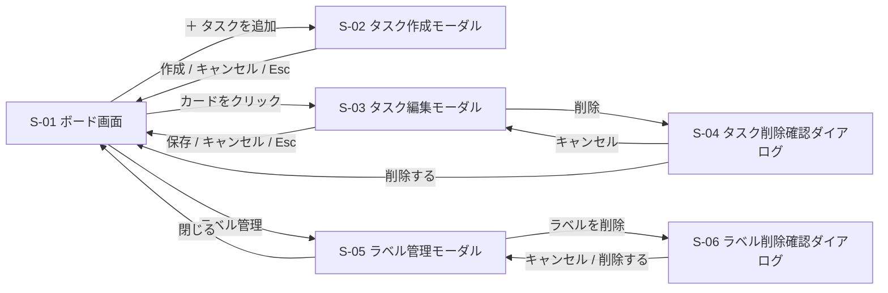

# 画面設計：TaskBoard

| 項目 | 内容 |
|---|---|
| 版 | v1.0 |
| 更新日 | 2026-10-20 |
| 親ドキュメント | [要件定義書](要件定義書.md) |

> 💡 **このドキュメントの役割**
> どんな画面があり、どう行き来し、それぞれの画面に何を出して何ができるかを決める。色や余白などの細かい見た目は実装のときに調整する。
>
> **IDの見方**：S 画面（このドキュメント）、F 機能・R 動作ルール（[機能一覧](機能一覧.md)）、N 非機能要件（[非機能要件](非機能要件.md)）、Q 決定事項（[要件定義書](要件定義書.md)）。

---

## 1. 画面一覧

| ID | 画面 | 種類 | 役割 |
|---|---|---|---|
| S-01 | ボード画面 | ページ | メイン画面。ボードの切り替え、カラムとカードの表示、D&D、チェック、整列、絞り込みを行う |
| S-02 | タスク作成モーダル | モーダル | 新しいタスクの内容を入力して作成する |
| S-03 | タスク編集モーダル | モーダル | タスクの内容を編集する。削除の入り口もここ |
| S-04 | タスク削除確認ダイアログ | ダイアログ | 削除してよいか確認する |
| S-05 | ラベル管理モーダル | モーダル | 開いているボードのラベルを作成・編集・削除する |
| S-06 | ラベル削除確認ダイアログ | ダイアログ | ラベルを削除してよいか確認する |

- ボードの切り替え・ボード名の変更・D&D・チェック・整列・絞り込みは、画面を移らずに S-01 の中で行う。
- 「読み込み中」「サーバーに接続できません」「エラーメッセージ」は S-01 の中に表示する状態で、別の画面ではない（3.2 の「画面の状態」）。

---

## 2. 画面遷移図



---

## 3. 画面要件

### 3.1 すべての画面に共通

| 項目 | 要件 | 根拠 |
|---|---|---|
| 言葉 | 日本語のみ | R-31 |
| モーダル・ダイアログの閉じ方 | ×ボタン・「キャンセル」・Esc で閉じる。外側をクリックしても閉じない | R-03 |
| 処理中のボタン | サーバーの返事を待っている間は、押したボタンを押せなくする | R-24 |
| エラーの出し方 | 画面上部に赤いメッセージを数秒出す。モーダルで失敗したときはモーダルを開いたまま出し、入力内容は残す | R-25 |
| フォーカス | モーダルを開いたら中の最初の入力欄に移り、閉じたら開いたボタンに戻る | N-21 |
| キーボード操作 | Tab で移動、Enter・Space で押す、Esc でモーダルを閉じる | N-19 |
| 読み上げ | アイコンだけのボタン（×、⋯ など）には読み上げ用の名前を付ける | N-24 |

### 3.2 S-01 ボード画面

**目的**：ボードのタスクを一覧し、移動・チェック・整列などの日常の操作をこの画面だけで行う。

```
[公開デモです。誰でも編集でき、毎日午前4時に見本データへ戻ります。個人情報は入力しないでください]
TaskBoard    [ 仕事 ]  プライベート         [ラベルで絞り込み ▼] [ラベル管理]
-------------------------------------------------------------------------------
 未着手 (2)        ⋯     作業中 (1)        ⋯     完了 (1)          ⋯
+--------------------+  +--------------------+  +--------------------+
| [緊急] [請求]      |  | [学習]             |  | [請求]             |
| ○ 企画書を書く     |  | ○ React入門        |  | ✓ 請求書を送る     |
|   優先:高  〆9/30  |  |   〆10/5           |  |   （取り消し線）   |
+--------------------+  +--------------------+  +--------------------+
+--------------------+
| ○ 資料を印刷       |
+--------------------+
 ＋ タスクを追加         ＋ タスクを追加         ＋ タスクを追加
```

**部品と操作**

| 部品 | 表示するもの | できる操作 | 関係する要件 |
|---|---|---|---|
| 公開デモの案内 | 画面の一番上に常に表示 | なし | F-54 |
| ボードのタブ | 2つのボード名。`[ 仕事 ]` が選択中 | クリックで切り替え。ダブルクリックで名前変更（Enter で確定、Esc で取り消し） | F-02, F-03, R-23 |
| ラベルで絞り込み | 開いているボードのラベル一覧 | 複数選べる。選んだラベルのどれかが付いたタスクだけ表示 | F-44, R-19〜R-22 |
| ラベル管理 | ボタン | S-05 を開く | F-43 |
| カラム見出し | カラム名と件数（絞り込み中は「表示中／全体」） | `⋯` から「優先度順」「期限順」で整列 | F-05, F-23, R-16, R-21 |
| カード | ラベル・チェックボックス・タイトル・優先度・期限・説明ありマーク（📝） | クリックで S-03 を開く。チェックボックスで ✓ の付け外し。ドラッグで移動 | R-08〜R-12, F-20, F-21 |
| ＋ タスクを追加 | 各カラムの一番下 | S-02 を開く | F-10 |

**画面の状態**

| 状態 | 表示 | 関係する要件 |
|---|---|---|
| 読み込み中 | 「読み込み中」を表示する | F-52 |
| 通常 | 上のイメージのとおり | |
| 絞り込み中 | 絞り込み中であることを表示する。D&D・整列・「＋ タスクを追加」は使えない（「＋ タスクを追加」は表示しない） | R-20 |
| サーバーに接続できない | 「サーバーに接続できません」と「再読み込み」ボタンを表示する | F-52, R-26 |
| 保存に失敗 | 画面上部に赤いメッセージ。D&D・チェックは元に戻す | R-24, R-25 |

### 3.3 S-02 タスク作成モーダル／S-03 タスク編集モーダル

**目的**：タスクの内容をまとめて入力する。作成と編集は同じ入力フォームを使い、見出しとボタンだけを変える（Q20）。

```
+---------------------------------------------+
| タスクを作成                            [×] |
|                                             |
| タイトル（必須）                            |
| [                                         ] |
| 説明                                        |
| [                                         ] |
| [                                         ] |
| カラム   [ 未着手 ▼ ]                       |
| 優先度   [ なし ▼ ]    期限 [ 日付を選ぶ ]  |
| ラベル   [緊急] [請求] [会議] ...（複数可） |
|                                             |
|                      [キャンセル]  [ 作成 ] |
+---------------------------------------------+
```

**作成と編集の違い**

| 項目 | 作成モーダル（S-02） | 編集モーダル（S-03） |
|---|---|---|
| 開き方 | カラム下の「＋ タスクを追加」 | カードをクリック |
| 見出し | タスクを作成 | タスクを編集 |
| 入力欄の初期値 | 空。「カラム」だけ押した場所が入る（R-02） | 今の内容 |
| 下のボタン | キャンセル／作成 | 削除／キャンセル／保存 |

**入力項目**

| 項目 | 入力のしかた | 必須 | ルール |
|---|---|---|---|
| タイトル | 1行の文字入力 | ○ | 100文字まで。前後の空白は取り除く。空（空白だけも含む）のときは「作成」「保存」を押せない（R-03, R-05, R-06） |
| 説明 | 複数行の文字入力 | | 1000文字まで。装飾なしの文章（R-06, R-07） |
| カラム | 選択（未着手／作業中／完了） | ○ | 編集で変えて保存すると、移動先の一番下に入る（R-04） |
| 優先度 | 選択（高／中／低／なし） | | 初期値は「なし」（F-13） |
| 期限 | カレンダーで日付を選ぶ | | 時刻なし。過去の日付も選べる。消すこともできる（F-14, R-11） |
| ラベル | 開いているボードのラベルから複数選ぶ | | 色＋名前で表示（F-40, R-09） |

### 3.4 S-04 タスク削除確認ダイアログ

**目的**：うっかり削除を防ぐ。

```
+-------------------------------------+
| このタスクを削除しますか？          |
| 「企画書を書く」                    |
| 削除すると元に戻せません。          |
|             [キャンセル] [削除する] |
+-------------------------------------+
```

| ボタン | 動き | 関係する要件 |
|---|---|---|
| キャンセル | ダイアログだけ閉じて、編集モーダル（S-03）に戻る | UC-03 |
| 削除する | 削除して、ダイアログと編集モーダルを閉じる | F-12, R-13 |

### 3.5 S-05 ラベル管理モーダル／S-06 ラベル削除確認ダイアログ

**S-05 の目的**：開いているボードのラベルを作成・編集・削除する。

| 部品 | 内容 | 関係する要件 |
|---|---|---|
| ラベルの一覧 | 開いているボードのラベルを、色と名前で並べる | F-41, F-42 |
| 色・名前の変更 | 各ラベルの色（6色）と名前（20文字まで、空でもよい）を変えられる | F-41, F-42, R-06 |
| ＋ ラベルを追加 | 新しいラベルを作る。1ボード20個まで。色も名前も同じラベルは作れない | F-43, R-17 |
| 削除 | 各ラベルの削除ボタン。S-06 を開く | F-43 |
| 閉じる | S-01 に戻る | |

**S-06 の目的**：ラベルを削除してよいか確認する。「このラベルは n 件のタスクから外れます。削除しますか？」と出し、「キャンセル」「削除する」を選ぶ（R-18）。

---

## 4. 未決事項

| No | 内容 | 決めるタイミング |
|---|---|---|
| 1 | S-05 でラベルの色・名前を変えたときの保存方法（変えたらすぐ保存するか、行ごとに「保存」ボタンを置くか） | 実装の前まで |

---

## 5. 変更履歴

| 版 | 日付 | 内容 |
|---|---|---|
| v1.0 | 2026-10-20 | 要件定義書 v2.0 の「画面設計」を移して作成。画面要件を画面ごとに「目的・部品と操作・画面の状態・入力項目」の形に整理し、全画面共通の要件と未決事項を追加 |
